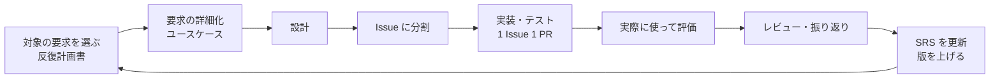

# プロジェクト計画書

- 文書 ID: PLAN-001
- 版: 0.4（承認）
- 作成日: 2026-10-14

## 1. 目的

Web アプリ「weekmeal」を題材に、要求定義から設計・実装・試験までのソフトウェアエンジニアリング工程を一通り実践し、各工程の成果物をトレーサブルな形で残す（E-32）。あわせて、開発者本人が日常で使い続けられるアプリにする（E-33）。

## 2. スコープ

### 2.1 対象

- **MVP**: 買った食材を 1 タップで登録し、主食と属性を設定すると、ホームで偏り（不足・過剰）が分かり、使い切った食材を外せる。本人が 1 週間、実際の買い物で使い続けられる最小構成
- MVP に含める要求: SRS-001 の優先度 M の要求すべて
- 優先度 S・C の要求は、MVP の後の反復で扱う

### 2.2 対象外

- SRS-001 7 章「将来の要求」（レシート入力、外食・コンビニ食、同期・アカウント）
- 凝ったデザイン、アニメーション
- サーバー側の実装（静的サイトとして配信する）

## 3. 開発プロセス

**反復型（インクリメンタル）開発**を採用する。1 回の反復の中で、小さな V 字（要求の詳細化 → 設計 → 実装 → 試験）を回す。

### 3.1 採用の理由

- 「個数のざっくり入力と 1,000 kcal あたりの割合で、偏りの判定が実感と合うか」は、実際の買い物で使ってみるまで分からない。計算の核を先に作り、早く確かめる
- 開発者本人が最初の利用者なので、反復ごとに実際に使って評価できる（E-33）
- 文書の量は減らさない。文書を作る時期を反復ごとに分散させ、要求の変更の経緯も記録として残す

### 3.2 文書の位置付け

| 文書 | 位置付け |
|---|---|
| 要求仕様書（SRS） | アプリ全体の要求の台帳。反復の結果を反映して版を上げる |
| 反復計画書 | 反復ごとに作る。目的（確かめたい仮説）、対象の要求 ID、作らないもの、完了条件を書く |
| 設計書 | 反復で扱う範囲だけを書き足していく。画面設計メモ（旧 docs/screen-design.md ほか）の内容は DES-IT02 に取り込み、メモは削除した（E-45） |
| テスト仕様書 | 反復で扱う要求ごとに書き足していく |
| 反復の振り返り | 反復の終わりに、仮説の検証結果と SRS への変更点を書く |

### 3.3 1 回の反復の流れ

- 反復の期間は 1〜2 週間を目安とする

### 3.4 反復の分け方（予定）

| 反復 | 名前 | 主な内容 | 主な要求 |
|---|---|---|---|
| IT01 | 計算の核とデータ | 開発基盤（テスト・lint・CI）、食品データの絞り込み、目安重量、基準値、量の換算・集計・判定のロジック。画面は既存の画面に判定結果を出す程度 | FR-FDB, FR-QTY, FR-NUT, FR-BAL-01〜05, FR-STP-03 |
| IT02 | 登録と判定の画面（MVP） | 画面の作り直し、1 タップ登録、個数の変更・使い切った、設定画面、保存 | FR-ING, FR-UI, FR-STP, FR-SYS |
| IT03 | 提案と仕上げ | 補う食材の提案、不足の程度の色表示、削除の取り消し、手入力の改善、E2E の拡充、性能とアクセシビリティ（詳細モードと食品一覧は IT02 で作った） | FR-BAL-06, 07, FR-ING-08, 14〜16, FR-UI-06, NFR-03, 04, 06 ほか（IT03-PLAN） |
| IT04 | 買い物の単位と公開 | 「使い切った」をやめて日付つきの買い物にまとめ、最新の買い物で判定する。前の買い物の履歴。過剰の程度の色、補う候補の棚のばらつき、GitHub Pages での公開 | FR-ING-17〜19, FR-NUT-07, FR-BAL-08, FR-SYS-03 ほか（IT04-PLAN） |

各反復の詳細は、前の反復の振り返りを受けて反復計画書で決める。

## 4. マイルストーン

| # | マイルストーン | 完了条件 | 状態 |
|---|---|---|---|
| M0 | 企画確定 | 企画書が承認されている | 完了（2026-10-14） |
| M1 | 要求の台帳の完成 | SRS v0.1 が確定している | 完了（2026-10-14） |
| M2 | 計算の核（IT01） | 本人の実際の買い物で判定を試し、仮説の検証結果が振り返りに記録されている | 完了（2026-10-14。H-01・H-03・H-04 は IT02 に持ち越し。REV-010） |
| M3 | MVP（IT02） | M の要求が実装され、テストが通り、本人が 1 週間使えている | 実装は完了（2026-10-15）。本人の 1 週間の利用（H-06）は IT02 振り返りの記入待ち |
| M4 | 仕上げ（IT03） | 提案が動き、トレーサビリティマトリクスが埋まり、ビルドして公開できる状態になっている。配信（配信先を決めて公開すること）は IT03 では行わない（E-54） | 完了（2026-10-25。H-07・H-08 の本人の感想は 2026-10-26 に記録。NFR-03 の実機の条件での確認は持ち越し。IT03-RETRO） |
| M5 | 買い物の単位と公開（IT04） | 買い物の単位で登録・判定・履歴が動き、GitHub Pages で公開されている | 着手（2026-10-26） |

## 5. 品質管理

- **レビュー**: 各工程の成果物はレビューし、指摘と対応を `docs/reviews/` に記録する（QA-07）
- **自動テスト**: 計算ロジックは Vitest の単体テストで検証し、命令網羅率 80% 以上とする（NFR-09, QA-02）。主要な利用の流れは Playwright の E2E テストで検証する（QA-03）
- **CI**: GitHub Actions で、型検査・lint・フォーマット確認・単体テスト・ビルドを実行する（QA-01）
- **構成管理**: Git で管理し、1 Issue 1 ブランチ、プルリクエスト経由で `main` にマージする（QA-06）。CI の成功と別エージェントによるレビューの承認を条件に、エージェントが自分でマージする。要求・企画の文書と運用ルール（AGENTS.md、CLAUDE.md、`.claude/`、計画書）を変える PR は本人の指示か承認を必須にし、設計への提案はエージェントの判断で採用して反復の振り返りで本人が確かめる（IT01-PLAN P-02、REV-009、AGENTS.md「自動マージの条件」）
- **設計判断**: 技術選定・データ形式・計算方式などは ADR として `docs/adr/` に残す（QA-08）

## 6. リスク

| リスク | 影響 | 対策 |
|---|---|---|
| 目安重量・基準値の手作りデータが不正確 | 判定が実感と合わない | 出典を記録し（QA-09）、IT01 で本人の買い物で試して直す |
| 「割合」による判定が直感と合わない | 製品の核が成り立たない | IT01 で計算の核だけ先に作り、仮説 H-01 で確かめる |
| 食品データを絞りすぎる・絞り足りない | 普段の食材が見つからない／一覧が長すぎる | 絞り込みを定義ファイルで管理し、追加・削除を簡単にする（FR-FDB-02）。H-03 で確かめる |
| スコープが膨らむ | MVP が完成しない | 反復ごとに対象の要求 ID を決め、それ以外は作らない。追加要望は SRS の「将来の要求」に分ける |
| 文書とコードが食い違う | トレーサビリティが崩れる | コミットやプルリクエストに FR/DES の ID を書き、マトリクスを反復ごとに更新する |

## 7. 変更履歴

| 版 | 日付 | 内容 |
|---|---|---|
| 0.1 | 2026-10-14 | 初版 |
| 0.2 | 2026-10-14 | レビューとマージをエージェントに任せる運用に変更（REV-009） |
| 0.3 | 2026-10-24 | IT03 の内容と M3・M4 を本人の決定に合わせて直した。公開は IT03 で行わない（E-52〜E-56、REV-026） |
| 0.4 | 2026-10-26 | IT04 の行と M5 を足し、M4 を完了にした（E-64〜E-69、REV-040） |
