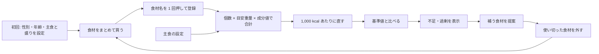

# 企画書「weekmeal」

- 文書 ID: CON-001
- 版: 0.2（ドラフト）
- 更新日: 2026-10-14
- 根拠: [要求抽出記録 ELI-001](elicitation-notes.md)。各項目の末尾の `E-xx` は、その根拠となった発言を指す

## 1. ひとことで

> 自炊のために買った食材を「1 つ」「1 袋」でざっくり入れるだけで、栄養の偏りが分かる。

## 2. 目標

**「簡単入力のみで管理する」**（E-03）

- 記録するのは食事ではなく、買った食材（E-08）
- 量はグラムではなく個数でざっくり。登録は食材名を 1 回押すだけ（E-10, E-22）
- 分かるのは「偏っているかどうか」と、補うなら何を買うか。摂取量の正確な管理はしない（E-09, E-19）

## 3. 開発の目的

| 目的 | 内容 | 根拠 |
|---|---|---|
| 就活 | 要求から設計・試験までを追える文書と、品質を説明できる実装を見せる | E-32, E-35 |
| 自分で使う | 既存アプリへの不満を解消し、本人が使い続けられるものにする | E-33 |

## 4. 既存アプリとの違い

| 観点 | 既存の食事記録アプリ | weekmeal |
|---|---|---|
| 主な対象 | 外食・コンビニ食（E-05） | 自炊（E-04） |
| 入力の単位 | 1 食ごと（E-06） | 買った食材ごと（E-08） |
| 量の入力 | グラム・人前 | 個数の概算。主食は盛りの大きさ（E-10, E-17） |
| 出力 | 1 日の摂取カロリー・栄養の絶対量 | 栄養の割合と、偏り（不足・過剰）の有無（E-09, E-11, E-18） |
| 期間 | 1 日・1 食 | 何日分でも成り立つ。使い切ったら外す（E-11, E-14） |

## 5. 基本ループ

## 6. 「割合」の考え方（E-12 で確定）

- 登録した食材の栄養を合計し、**エネルギー 1,000 kcal あたりの量**に直す
- 基準値（1 日の推奨量など）も同じく **1,000 kcal あたり**に直す
- 両者の比（充足率）で偏りを判定する
- 合計を「エネルギーあたり」に直すので、食材が 3 日分でも 7 日分でも結果は変わらない
- たんぱく質・脂質・炭水化物は、エネルギー比率（PFC バランス）で判定する

例: キャベツ 1 玉、にんじん 3 本、豚こま 1 パックを登録し、主食を「ご飯・中盛り」に設定 → ビタミン C は足りている、たんぱく質の比率が低い、と分かる。

## 7. 主食の扱い（E-15〜E-17）

- 米・パン・麺は、買った食材としては登録しない（5kg の米が割合を大きく偏らせるため）
- 代わりに設定で「主食の種類」と「盛り（小盛り・中盛り・大盛り）」を選ぶ
- 盛りごとに、主食が全体のエネルギーに占める比率を決める（小盛り 30%、中盛り 40%、大盛り 50%）。何日分かを入力せずに済む（E-37）

## 8. 作らないもの

| 作らないもの | 根拠 |
|---|---|
| 外食・コンビニ食の記録 | E-04 |
| 1 食ごと・1 日ごとの食事記録 | E-06, E-08 |
| グラム単位の量の入力を必須にすること | E-10 |
| 摂取カロリーや栄養の絶対量の管理、「摂取不足」の断定 | E-09, E-29 |
| 調味料・油など、長く使う物の登録 | E-15 |

## 9. 未決事項

| # | 論点 | メモ |
|---|---|---|
| Q-01 | ~~「割合」の基準~~ | **決定（E-12）**: 1,000 kcal あたり |
| Q-02 | ~~「1 つ」の重さのデータ~~ | **決定（E-13）**: よく買う食材に絞って手で作る |
| Q-03 | ~~集計の期間~~ | **決定（E-14）**: 「使い切った」で外す |
| Q-04 | ~~長く使う食材~~ | **決定（E-15, E-16）**: 登録の対象外。主食は設定で持つ |
| Q-05 | ~~判定のあとに見せるもの~~ | **決定（E-18, E-19）**: 不足・過剰の表示は必須、提案もできれば行う |
| Q-06 | ~~利用者と端末~~ | **決定（E-30, E-31）**: 性別・年齢を選べる。スマホ優先で PC にも対応 |
| Q-07 | ~~主食の栄養を、ほかの食材の合計とどう合わせるか~~ | **決定（E-37）**: 盛りごとに、主食が全体のエネルギーに占める比率を決める |
| Q-08 | レシート入力をいつ扱うか | E-29。将来の構想 |
