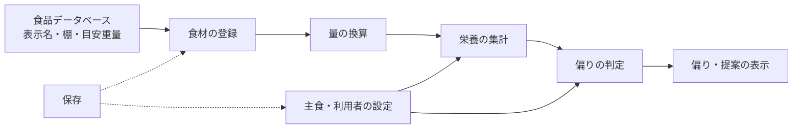

# 要求仕様書（SRS）「weekmeal」

- 文書 ID: SRS-001
- 版: 0.2（確定）
- 作成日: 2026-10-14
- 位置付け: アプリ全体の要求の台帳。設計・実装・試験は本書の要求 ID を基準に行う
- 構成の参考: ISO/IEC/IEEE 29148、IEEE 830

## 1. はじめに

### 1.1 目的

本書は、Web アプリ「weekmeal」が満たすべき要求を定義する。設計・実装・試験は本書の要求 ID を基準に行い、トレーサビリティマトリクスで対応を管理する。

### 1.2 範囲

自炊のために購入した食材の登録と、その食材群の栄養の偏りの判定・表示を扱う。外食・コンビニ食、1 食ごとの食事記録は扱わない（CON-001 8 章）。

画面の構成と操作の流れは、次の文書を参考にする（E-36, E-45）。本書と食い違う場合は本書を優先する。これらのメモは設計書（03_design）に取り込んだあと削除する。

- [画面設計メモ](../screen-design.md)
- [画面遷移図](../screen-flow.md)
- [データ設計](../data-design.md)

### 1.3 用語

| 用語 | 定義 |
|---|---|
| 食品データベース | 文部科学省「日本食品標準成分表（八訂）増補2023年」から、スーパーで買える自炊向けの食品だけを抜き出した、食品と成分値の一覧（`src/data/foods.json`、FR-FDB-01） |
| 代表食品 | 一般的な食材名（例: あじ）にまとめた複数の食品のうち、登録時に使う 1 つ（原則として「生」） |
| 棚 | 食材を探すための、スーパーの売場に近い分類。14 種（docs/screen-design.md） |
| よくある食材 | 一般的なスーパーで見つけやすい食材。`src/data/supermarketFoods.ts` で管理する |
| 食材 | 利用者が登録した、買った食べ物 1 件。食品データベースの食品、または手入力の食品を参照する |
| 個数 | 食材の量を表す、利用者にとって自然な数え方（1 本、1 玉、1 パック、1 袋など）での数 |
| 単位 | 個数の数え方（本、玉、パック、袋など） |
| 目安重量 | 1 単位あたりの可食部の重さ（g）。個数から成分値を計算するために使う |
| 主食 | ご飯・パン・麺など。食材としては登録せず、設定として持つ |
| 盛り | 主食の量の目安。小盛り・中盛り・大盛りの 3 段階 |
| 集計対象 | 偏りの判定に含める食材の集合。登録済みで、「使い切った」にしていない食材と、設定した主食 |
| 栄養の割合 | 集計対象の栄養の合計を、エネルギー 1,000 kcal あたりの量に直したもの |
| 基準値 | 偏りを判定するための、栄養素ごとの基準となる量。利用者の性別・年齢区分で決まる |
| 充足率 | 栄養の割合 ÷ 基準値（同じく 1,000 kcal あたりに直したもの） |
| 偏り | 充足率が決められた範囲（TBD-03）の外にある状態。「不足」と「過剰」がある |

### 1.4 参考文献

| ID | 文書 |
|---|---|
| ELI-001 | [要求抽出記録](../01_concept/elicitation-notes.md) |
| CON-001 | [企画書](../01_concept/concept.md) |
| — | [画面設計メモ](../screen-design.md)、[画面遷移図](../screen-flow.md)、[データ設計](../data-design.md) |

## 2. 全体の記述

### 2.1 製品の位置付け

ブラウザで動く個人用の Web アプリ。買った食材を個数でざっくり登録し、主食を設定すると、食材全体の栄養の割合を計算して、偏り（不足・過剰）と補う食材を表示する。目標は「簡単入力のみで管理する」（E-03）。

### 2.2 製品の主な機能

### 2.3 利用者

| 利用者 | 特性 | 主な関心 |
|---|---|---|
| 自炊する人 | 数日〜1 週間分の食材をまとめて買う。栄養の細かい数値には関心が薄い。記録の手間を嫌う。主にスマートフォンで使う | 入力が少ないこと、偏りがひと目で分かること、次に何を買えばよいか |
| 開発者 | 本プロジェクトの保守者。本人が最初の利用者でもある（E-33） | テストしやすさ、文書とコードの対応 |
| 評価者 | ポートフォリオを見る採用担当者・エンジニア（E-32） | 要求から実装・試験まで追えること、品質の裏付け |

### 2.4 制約

| ID | 制約 | 根拠 |
|---|---|---|
| CST-01 | 成分値は「日本食品標準成分表（八訂）増補2023年」を使い、原典の値を書き換えない。出典を画面に表示する | 既存の実装、docs/data-design.md |
| CST-02 | 実装は TypeScript・React・Vite で行う | 既存の実装 |
| CST-03 | 本アプリは医療・栄養指導の代わりではない。判定は「買った食材の傾向」であり、摂取量の不足・過剰とは断定しない表現にする | E-09, E-29 |
| CST-04 | 食品データベースに存在しない商品（コーラなど）に、架空の成分値を作らない | docs/screen-design.md |

### 2.5 前提と依存

- 利用者は最新版のブラウザ（iOS Safari、Android Chrome、PC の Chrome・Edge・Safari・Firefox）を使う
- 利用者は 1 人。家族分の食材を買っても、割合で判定するため人数は入力しない
- 基準値の出典は TBD-02

## 3. 機能要求

### 要求の書き方

- **優先度**（MoSCoW）: M = 必須、S = あるべき、C = あると良い、W = 今回は作らない
- **検証方法**: T = テスト、D = 実演、I = 査閲（文書やコードを読んで確認）、A = 分析
- **TBD**: 未決の値。9 章の一覧で管理する

### 3.1 食材の登録（ING）

| ID | 要求 | 根拠 | 優先度 | 検証 |
|---|---|---|---|---|
| FR-ING-01 | 利用者は、登録画面で食材名を 1 回押すだけで食材を登録できること。状態・部位・量は登録時に選ばせない | E-03, E-22 | M | T |
| FR-ING-02 | 食材の一覧は、棚（14 種）で絞り込めること | E-28 | M | T |
| FR-ING-03 | 食材の一覧は、名前の検索で絞り込めること | E-21, E-28 | M | T |
| FR-ING-04 | 未検索時は、よくある食材を先に表示すること。それ以外の食材は一覧の後半と検索結果に表示すること | E-13, E-28 | M | T |
| FR-ING-05 | 食品データベースの食品は、一般的な食材名にまとめて表示し、押したときは代表食品（原則「生」）で登録すること | E-27 | M | T |
| FR-ING-06 | 栄養が大きく異なり、スーパーで別の商品とされる食品（から揚げ、漬物、缶詰など）は、別の食材名として表示すること | E-27 | S | T |
| FR-ING-07 | 詳細モードでは、文科省の正式名称・状態・食品番号を表示し、個別の食品を選んで登録できること | E-26 | S | T |
| FR-ING-08 | 利用者は、食品データベースにない食材を、名前と棚を入力して登録できること。成分値の入力は任意とし、入力しない場合は集計から除き、その旨を表示すること | E-23, E-44 | S | T |
| FR-ING-09 | 米・パン・麺・調味料・油など長く使う物は、登録の一覧に出さないこと（主食は FR-STP で扱う）。対象は TBD-10 | E-15 | M | T |
| FR-ING-10 | 利用者は、登録した食材の個数を変更し、削除できること | E-03 | M | T |
| FR-ING-11 | 利用者は、登録した食材を「使い切った」にでき、使い切った食材は集計対象から外れること | E-14 | M | T |
| FR-ING-12 | 「使い切った」は 1 回の操作で取り消せること | E-03 | S | T |
| FR-ING-13 | 1 食ごとの食事を記録する機能は持たないこと | E-06, E-08 | M | I |

### 3.1a 食品データ（FDB）

| ID | 要求 | 根拠 | 優先度 | 検証 |
|---|---|---|---|---|
| FR-FDB-01 | アプリに同梱する食品データは、文科省の成分表のうち、スーパーで買える自炊向けの食品に絞ること | E-42, E-43 | M | I |
| FR-FDB-02 | 絞り込みの対象は定義ファイルで管理し、変換スクリプトで成分表から食品データを生成すること。成分値は原典から書き換えないこと（CST-01） | E-42, CST-01 | M | T |
| FR-FDB-03 | 絞り込みで外れた食品は、手入力（FR-ING-08）で補えること | E-44 | M | D |

### 3.2 量の換算（QTY）

| ID | 要求 | 根拠 | 優先度 | 検証 |
|---|---|---|---|---|
| FR-QTY-01 | 食材の量は、個数（その食材の単位での数）で表すこと。登録時の個数は 1 とする | E-10, E-22 | M | T |
| FR-QTY-02 | よくある食材ごとに単位と目安重量を持ち、個数 × 目安重量で重さを求めること | E-10, E-13 | M | T |
| FR-QTY-03 | 目安重量は、廃棄部分を除いた可食部の重さとすること | CST-01 | S | T |
| FR-QTY-04 | 個数は 0.5 単位で増減できること（半玉、半パックなど） | E-10 | S | T |
| FR-QTY-05 | 目安重量を持たない食材は、1 単位 = 100g として扱い、概算であることを表示すること | E-10 | M | T |
| FR-QTY-06 | グラム単位の量の入力を必須にしないこと | E-10 | M | I |

### 3.3 主食と利用者の設定（STP）

| ID | 要求 | 根拠 | 優先度 | 検証 |
|---|---|---|---|---|
| FR-STP-01 | 利用者は、主食の種類（ご飯・パン・麺・なし）を設定できること | E-16 | M | T |
| FR-STP-02 | 利用者は、主食の盛り（小盛り・中盛り・大盛り）を設定できること | E-17 | M | T |
| FR-STP-03 | 主食の設定を、集計に反映すること。反映の方式は TBD-14 | E-16, E-17 | M | T |
| FR-STP-04 | 利用者は、性別と年齢区分を設定でき、基準値に反映されること | E-30 | M | T |
| FR-STP-05 | 初回の起動時は、設定をしなくても、初期値（TBD-15）で使い始められること | E-03 | M | D |

### 3.4 栄養の集計（NUT）

| ID | 要求 | 根拠 | 優先度 | 検証 |
|---|---|---|---|---|
| FR-NUT-01 | 集計対象の食材ごとに、重さ × 100g あたりの成分値 ÷ 100 で栄養素の量を求め、合計すること | E-11 | M | T |
| FR-NUT-02 | 合計を、エネルギー 1,000 kcal あたりの量（栄養の割合）に直すこと | E-11, E-12 | M | T |
| FR-NUT-03 | 栄養の割合は、主食以外の食材の個数を一律に何倍にしても変わらないこと（何日分でも成り立つ） | E-11 | M | T |
| FR-NUT-04 | たんぱく質・脂質・炭水化物は、エネルギーに占める比率（PFC バランス）でも表すこと | E-11 | S | T |
| FR-NUT-05 | 成分値が「データなし」の栄養素は 0 として扱わず、データのある食材だけで計算し、データの欠けがあることを表示すること | CST-01 | S | T |
| FR-NUT-06 | 集計対象は、利用者が登録した食材と主食だけとし、食品データベースの食品を混ぜないこと | E-20 | M | T |

### 3.5 偏りの判定（BAL）

| ID | 要求 | 根拠 | 優先度 | 検証 |
|---|---|---|---|---|
| FR-BAL-01 | 栄養素ごとに、栄養の割合を基準値と比べて充足率を求めること。基準値の出典は TBD-02 | E-09, E-25 | M | T |
| FR-BAL-02 | 充足率が TBD-03 の範囲を下回る栄養素を「不足」と判定すること | E-18 | M | T |
| FR-BAL-03 | 上限が問題になる栄養素（食塩相当量、脂質など）は、充足率が TBD-03 の範囲を上回ったとき「過剰」と判定すること | E-18 | M | T |
| FR-BAL-04 | 判定の対象とする栄養素を定めること。対象は TBD-11 | E-24 | M | I |
| FR-BAL-05 | 集計対象が少なすぎて判定に意味がないとき（TBD-12）、判定せず、その旨を表示すること | E-09 | S | T |
| FR-BAL-06 | 不足している栄養素を多く含む食材を、補う候補として表示すること。候補はよくある食材から選び、登録の一覧に出せる食材に限ること | E-19 | S | T |
| FR-BAL-07 | 補う候補は、追加したときに不足が減り、ほかの栄養素の過剰を新たに生まないものを優先すること | E-19 | C | T |

### 3.6 表示（UI）

| ID | 要求 | 根拠 | 優先度 | 検証 |
|---|---|---|---|---|
| FR-UI-01 | 最初の画面（ホーム）で、偏りの判定結果（不足・過剰の栄養素）をひと目で分かるように表示すること | E-09, E-20 | M | D |
| FR-UI-02 | 画面は、ホーム・食材登録・食品一覧・栄養詳細・設定とすること。遷移は設計書で定める | E-36 | M | D |
| FR-UI-03 | ホームから、食材の登録と、登録済み食材の一覧（個数の変更・使い切った）に 1 タップで移れること | E-03 | M | D |
| FR-UI-04 | 登録画面は、簡易モードを初期状態とし、詳細モードと切り替えられること | E-26 | S | D |
| FR-UI-05 | 栄養詳細画面で、栄養素ごとの充足率を一覧表示できること（基本栄養素・ビタミン・ミネラル） | E-24 | M | D |
| FR-UI-06 | 判定の数値（g や mg）より、偏りの有無と程度を優先して見せること | E-09 | M | I |
| FR-UI-07 | 判定結果の表示は、「買った食材の傾向」であることが分かる言い回しにすること（CST-03） | E-29 | M | I |
| FR-UI-08 | 食品一覧画面で、食品データベースの食品を検索し、100g あたりの成分を見られること | E-21 | S | D |
| FR-UI-09 | 主食・性別・年齢区分を設定する画面を持つこと | E-16, E-30 | M | D |

### 3.7 システム（SYS）

| ID | 要求 | 根拠 | 優先度 | 検証 |
|---|---|---|---|---|
| FR-SYS-01 | 登録した食材と設定を保存し、ブラウザを閉じても再び開いたときに残っていること。保存先は TBD-13 | E-03 | M | T |
| FR-SYS-02 | 利用者の登録やログインなしで使えること | E-03 | M | D |

### 3.8 将来の機能

| ID | 要求 | 根拠 | 優先度 | 検証 |
|---|---|---|---|---|
| FR-RCP-01 | レシートを撮影または画像から選び、商品名を食材名にまとめて一括で登録できること | E-29 | W | — |

## 4. 外部インタフェース要求

| ID | 要求 | 優先度 | 検証 |
|---|---|---|---|
| IF-01 | 画面の表示言語は日本語とすること | M | I |
| IF-02 | タッチ操作とマウス・キーボード操作の両方で、すべての機能を使えること | M | D |
| IF-03 | 画面の幅 360px（スマートフォン）で、横スクロールなしに使えること | M | T |
| IF-04 | 画面の幅 1280px 以上（PC）で、レイアウトが崩れず使えること | S | T |
| IF-05 | タップできる要素は、44 × 44 CSS px 以上の大きさを持つこと | M | T |

## 5. 非機能要求

| ID | 区分 | 要求 | 優先度 | 検証 |
|---|---|---|---|---|
| NFR-01 | 使用性 | 初めての利用者が、説明を読まずに食材を 1 件登録し、ホームで判定結果を見られること | M | D |
| NFR-02 | 使用性 | ホームを開いてから食材 1 件の登録を終えるまで、3 タップ以内であること | M | T |
| NFR-03 | 性能 | 食材の登録・個数変更・使い切ったから、判定結果の更新まで 100 ms 以内であること（中位のスマートフォン相当） | S | T |
| NFR-04 | 性能 | Lighthouse（Chrome 付属の診断ツール）のモバイル計測で、Performance スコアを記録すること。目標値は設けない | C | T |
| NFR-05 | — | （v0.1 で削除。食品データを絞る FR-FDB-01 で転送量の問題は解消するため） | — | — |
| NFR-06 | アクセシビリティ | axe（アクセシビリティの自動検査ツール）を E2E テストに組み込み、重大な違反を検出すること | C | T |
| NFR-07 | アクセシビリティ | 不足・過剰を、色だけでなく文字やアイコンでも区別できること | M | I |
| NFR-08 | 保守性 | 量の換算・栄養の集計・偏りの判定・提案のロジックは、React に依存しない純粋な関数として実装すること | M | I（依存関係の検査を CI で自動化する） |
| NFR-09 | 保守性 | NFR-08 のロジックの命令網羅率が 80% 以上であること | M | T |
| NFR-10 | 保守性 | TypeScript の strict モードを有効にし、`any` を使わないこと（やむを得ない場合は理由をコメントに書く） | M | I（lint で自動化する） |
| NFR-11 | 保守性 | 目安重量・表示名・棚の定義データは、食品データベースに存在する食品番号だけを参照すること | M | T（データの整合性テスト） |
| NFR-12 | 信頼性 | 保存データが壊れていても、アプリが異常終了しないこと（初期状態で起動し、その旨を表示する） | M | T |
| NFR-13 | 互換性 | 保存データにバージョンを持ち、旧い版の保存データを読み込めること | S | T |
| NFR-14 | プライバシー | 登録した食材と設定のデータを外部に送信しないこと | M | I |
| NFR-15 | 正確性 | 栄養の集計の計算結果が、手計算による期待値と一致すること（小数第 2 位まで） | M | T |

## 6. 品質保証の要求

| ID | 要求 |
|---|---|
| QA-01 | プルリクエストとプッシュごとに、CI（GitHub Actions）で型検査・lint・フォーマット確認・単体テスト・ビルドを実行し、すべて通ったものだけを main に取り込むこと |
| QA-02 | 単体テストは Vitest で書き、NFR-08 のロジックの網羅率を CI で計測して、NFR-09 の基準を下回ったら失敗にすること |
| QA-03 | 主要な利用の流れ（食材の登録 → ホームで判定を見る → 使い切った → 主食・属性の設定）を、E2E テスト（Playwright）でスマートフォンと PC の画面幅の両方について自動化すること |
| QA-04 | NFR-04 の計測は、反復の終わりに手動で行い、結果を反復の記録に残すこと |
| QA-05 | すべての M・S 要求は、トレーサビリティマトリクスで設計要素とテストケースに対応付けること |
| QA-06 | 実装作業は GitHub Issue 単位で行い、Issue・ブランチ・プルリクエストに要求 ID を書くこと |
| QA-07 | 各工程の成果物（SRS、設計、テスト仕様）はレビューし、記録を `docs/reviews/` に残すこと |
| QA-08 | 重要な設計判断（技術選定、データ形式、計算方式など）は ADR として `docs/adr/` に残すこと |
| QA-09 | 基準値・目安重量など、外部資料に基づく数値には、出典（資料名・版・該当箇所）をデータの近くに記録すること |

## 7. 将来の要求（今回は作らない）

| 内容 | 根拠 |
|---|---|
| レシート入力（FR-RCP-01） | E-29 |
| 外食・コンビニ食の記録 | E-04 |
| 1 食ごと・1 日ごとの食事記録、摂取カロリーの管理 | E-06, E-09 |
| 複数端末での同期、アカウント | — |

## 8. 要求の一覧（集計）

| 区分 | M | S | C | W |
|---|---|---|---|---|
| 機能要求（52 件） | 38 | 12 | 1 | 1 |

## 9. 未決事項（TBD）

| ID | 内容 | 関連 | 状態 | 仮置き |
|---|---|---|---|---|
| TBD-01 | 「割合」の定義 | FR-NUT-02 | **解決（v0.1）: 1,000 kcal あたり**（E-12） | — |
| TBD-02 | 基準値の出典 | FR-BAL-01 | **解決（v0.1）: 厚生労働省「日本人の食事摂取基準（2025年版）」の推奨量・目安量・目標量**（E-38） | — |
| TBD-03 | 「不足」「過剰」と判定する充足率の範囲 | FR-BAL-02, 03 | **解決（v0.1）: 不足は 70% 未満、過剰は上限のある栄養素で 130% 超**（E-38） | — |
| TBD-04 | 登録の一覧に出す食材の選び方 | FR-ING-04 | **解決（v0.1）: よくある食材（`supermarketFoods.ts`）を起点に手で選ぶ**（E-13） | — |
| TBD-05 | 1 回の登録のタップ数の上限 | FR-ING-01, NFR-02 | **解決（v0.1）: 登録画面で 1 タップ、ホームから 3 タップ以内**（E-22） | — |
| TBD-06 | 家族分の食材の扱い | 2.5 | **解決（v0.1）: 人数は入力しない**（割合で判定するため） | — |
| TBD-07 | 主に使う端末 | IF-03, 04 | **解決（v0.1）: スマートフォン優先、PC にも対応**（E-31） | — |
| TBD-08 | 目安重量のデータの出典 | FR-QTY-02 | **解決（v0.1）: よくある食材の品目ぶんを、公開資料を参考に手で作る**（E-13）。出典は QA-09 に従って記録する | — |
| TBD-09 | 集計対象から古い食材を外す方式 | FR-ING-11 | **解決（v0.1）: 「使い切った」で外す**（E-14） | — |
| TBD-10 | 登録の一覧から外す、長く使う物の範囲 | FR-ING-09 | **解決（v0.2）: 米・パン・麺・調味料・油は外す。乾物・粉類（はるさめ、片栗粉、あずき、ひよこまめ など）は登録できる食材として食品データに入れる**（E-15、REV-010） | — |
| TBD-11 | 判定の対象とする栄養素 | FR-BAL-04 | **解決（v0.1）: たんぱく質・脂質・炭水化物（PFC 比率）、食物繊維、食塩相当量、ビタミン A・B1・B2・C・D、鉄、カルシウム、カリウム、亜鉛 の 14 種。ほかは栄養詳細画面で充足率だけ表示する**（E-39, E-40） | — |
| TBD-12 | 判定に必要な最低限の量 | FR-BAL-05 | 未決 | 主食を除いて 3 品目未満なら判定しない |
| TBD-13 | 保存先 | FR-SYS-01 | 未決 | ブラウザの localStorage |
| TBD-14 | 主食を集計に反映する方式 | FR-STP-03 | **解決（v0.1）: 盛りごとに、主食が全体のエネルギーに占める比率を決める（小盛り 30%、中盛り 40%、大盛り 50%）**（E-37） | — |
| TBD-15 | 設定の初期値 | FR-STP-05 | 未決 | 主食: ご飯・中盛り、性別: 未選択（男女の平均）、年齢: 30〜49 歳 |
| TBD-16 | 初回の読み込みの転送量の上限 | NFR-05 | **取り下げ（v0.1）**: NFR-05 の削除による（E-41, E-42） | — |

保留の TBD は、関係する要求を実装するときまでに決める。

## 10. 変更履歴

| 版 | 日付 | 内容 |
|---|---|---|
| 0.0 | 2026-10-14 | 初版ドラフト（ELI-001 の E-01〜E-25 から作成） |
| 0.1 | 2026-10-14 | 要求レビュー（E-12〜E-19、E-26〜E-36）を反映。主食と利用者の設定（STP）を追加。画面は screen-design.md・screen-flow.md を参考とした。品質の要求を具体化。TBD-01〜09・11・14 を解決。食品データの絞り込み（FDB）を追加し、品質の要求を軽くした（E-40〜E-44）。レビュー REV-001 で確定 |
| 0.2 | 2026-10-14 | TBD-10 を解決（乾物・粉類を登録できる食材に入れる。REV-010） |
