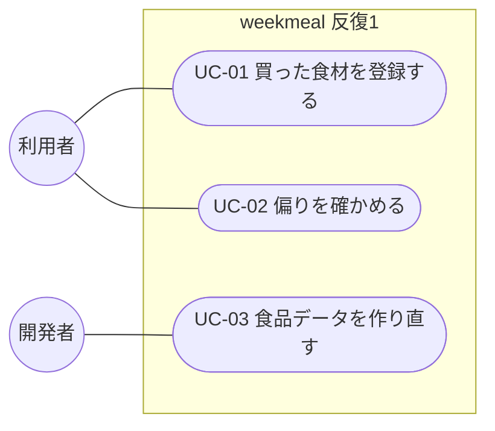

# ユースケース

- 文書 ID: UC-DOC-001
- 版: 0.1（反復 1 の範囲）
- 作成日: 2026-10-14
- 対象: [反復 1 計画書](../iterations/it01/plan.md) の範囲。反復ごとに書き足す

## 1. アクター

| アクター | 説明 |
|---|---|
| 利用者 | 自炊のために食材をまとめて買う人 |
| 開発者 | 食品データ・目安重量・基準値の定義を保守する人 |

## 2. ユースケース図

## 3. ユースケース記述

### UC-01 買った食材を登録する

| 項目 | 内容 |
|---|---|
| アクター | 利用者 |
| 関連要求 | FR-ING-01〜05, 09, FR-QTY-01, 02, 05 |
| 事前条件 | 食品データが読み込まれている |
| 事後条件 | 食材が個数 1 で登録されている |

**基本フロー**
1. 利用者は食材登録画面を開く
2. システムは、登録できる食材名の一覧を、よくある食材を先にして表示する（米・パン・麺・調味料・油は出さない）
3. 利用者は、必要なら棚や名前で一覧を絞り込む
4. 利用者は食材名を押す
5. システムは、その食材名の代表食品を個数 1 で登録する

**代替フロー**
- 5a. 食材に目安重量がないとき、システムは 1 単位を 100g として扱い、概算であることを示す

### UC-02 偏りを確かめる

| 項目 | 内容 |
|---|---|
| アクター | 利用者 |
| 関連要求 | FR-NUT-01〜06, FR-STP-03, FR-BAL-01〜05, FR-UI-01, 07 |
| 事前条件 | 主食・性別・年齢区分の設定がある（反復 1 では初期値） |
| 事後条件 | なし（表示のみ） |

**基本フロー**
1. 利用者はホームを開く
2. システムは、登録した食材の量を換算し、主食を足して、1,000 kcal あたりの割合を求める
3. システムは、基準値と比べて不足・過剰の栄養素を判定する
4. システムは、不足・過剰の栄養素を、「買った食材の傾向」である旨とともに表示する

**代替フロー**
- 2a. 主食を除く食材が 3 品目未満のとき、システムは判定せず、もっと登録するよう促す
- 3a. ある栄養素について、すべての食材でデータがないとき、その栄養素は「不明」と表示する

### UC-03 食品データを作り直す

| 項目 | 内容 |
|---|---|
| アクター | 開発者 |
| 関連要求 | FR-FDB-01, 02, NFR-11 |
| 事前条件 | 成分表の Excel を取得している |
| 事後条件 | `src/data/foods.json` が絞り込みの定義どおりに更新されている |

**基本フロー**
1. 開発者は `scripts/food-selection.json` に食品番号を追加・削除する
2. 開発者は変換スクリプトを実行する
3. システムは、定義にある食品だけを、廃棄率とともに書き出す
4. 開発者は整合性テストを実行し、定義データの参照がすべて食品データにあることを確かめる

**代替フロー**
- 3a. 定義にある食品番号が Excel にないとき、システムは食品番号を表示して誤りで終了する
