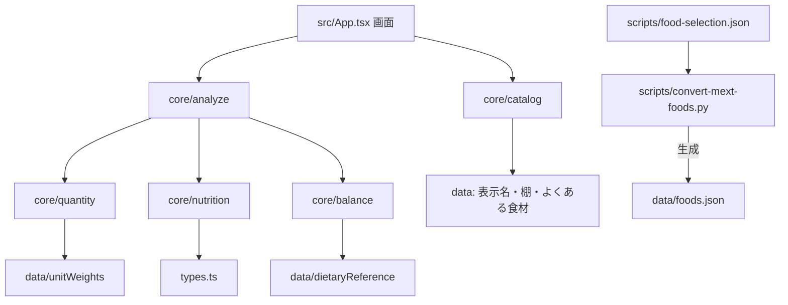

# 設計書（反復 1）: 計算の核とデータ

- 文書 ID: DES-IT01
- 版: 0.2（採用。自動マージの条件 4 により、エージェントの判断で採用。REV-009。本人には IT02 の振り返りで提示する）
- 作成日: 2026-10-14
- 対象: [反復 1 計画書](../iterations/it01/plan.md) の範囲
- 根拠: [SRS-001](../02_requirements/srs.md)、[ADR-0001](../adr/0001-tech-stack.md)、[ADR-0002](../adr/0002-food-data.md)、[ADR-0003](../adr/0003-balance-calculation.md)

> IT04 注記（2026-10-31）: 本文の DES-ANL-01 にある `usedUp` 除外と `RegisteredItem.usedUp` は、[DES-IT04](design-it04.md) の DES-SHP-03 で置き換える。換算・集計・判定の規則は継続する。

## 1. アーキテクチャ

### 1.1 パッケージ構成（DES-PKG）

| ID | 場所 | 責務 | 依存してよい先 |
|---|---|---|---|
| DES-PKG-01 | `src/core/` | 表示名のまとめ、量の換算、栄養の集計、偏りの判定。**純粋な関数だけ**を置く | `src/types.ts`、`src/data/`（`.ts` の定義） |
| DES-PKG-02 | `src/data/` | 静的な定義データ（食品データ、表示名、棚、よくある食材、目安重量、基準値、栄養素の定義） | `src/types.ts` |
| DES-PKG-03 | `src/`（`App.tsx` など） | 画面。IT02 で `src/ui/` に整理する | すべて |
| DES-PKG-04 | `scripts/` | 食品データの生成（Python）、Node のバージョン確認 | なし |
| DES-PKG-05 | `eslint.config.js` | `src/core/` から `react`・`react-dom`・画面のモジュールを import したら lint の誤りにする（NFR-08） | — |

`src/core/` の約束:

- React・DOM・`localStorage`・`Date.now()`・`Math.random()` を使わない
- 引数を変更しない（新しい値を返す）
- 例外を投げず、判定できないときは状態（`unknown` など）を値として返す



### 1.2 開発基盤（DES-DEV）

| ID | 内容 |
|---|---|
| DES-DEV-01 | `npm run typecheck`（`tsc -b`）、`npm run lint`（ESLint）、`npm run format:check`（Prettier）、`npm test`（Vitest）、`npm run test:coverage`、`npm run build` を用意する |
| DES-DEV-02 | Vitest の網羅率の対象は `src/core/**`。命令網羅率 80% を下回ったら失敗にする（NFR-09） |
| DES-DEV-03 | GitHub Actions（`.github/workflows/ci.yml`）で、プッシュとプルリクエストごとに DES-DEV-01 をすべて実行する（QA-01） |
| DES-DEV-04 | ESLint で `@typescript-eslint/no-explicit-any` を誤りにする（NFR-10） |

## 2. データ

### 2.1 食品データ（DES-FDB）

| ID | 内容 |
|---|---|
| DES-FDB-01 | 絞り込みの定義 `scripts/food-selection.json`: `[{ "id": "06212", "name": "にんじん 根 皮つき 生" }, ...]`。`name` は読みやすさのためで、変換には使わない（ADR-0002） |
| DES-FDB-02 | 変換スクリプト: `python3 scripts/convert-mext-foods.py INPUT.xlsx OUTPUT.json --select scripts/food-selection.json`。定義にある食品だけを出力し、定義にあって Excel にない食品番号があれば誤りで終了する。REFUSE 列を `refusePct` として出力する |
| DES-FDB-03 | `FoodItem` 型に `refusePct: number \| null` を加える |
| DES-FDB-04 | 整合性テスト（`src/data/integrity.test.ts`）: 絞り込みの定義と食品データの食品番号が一致すること、棚の個別設定・表示名の代表食品・目安重量・主食の代表食品が食品データに存在すること（NFR-11） |
| DES-FDB-05 | 主食の代表食品（ADR-0003）: ご飯 `01088`、パン `01026`、麺 `01039`。`src/data/staples.ts` に置く |

定義の初版の作り方（ADR-0002）: よくある食材（`supermarketFoods.ts`）に、自炊でよく買う食材名を足して 150〜250 個にし、それぞれの食材名にまとまる食品をすべて含める。米・パン・麺・調味料・油は、主食の代表食品を除いて含めない（FR-ING-09）。

### 2.2 目安重量（DES-QTY-01）

```ts
// src/data/unitWeights.ts
export type UnitWeight = {
  unit: string;        // 本、玉、パック など
  purchaseG: number;   // 購入時の 1 単位の重さ（廃棄部分を含む）
  refusePct?: number;  // 買うときの形の廃棄率。切り身・むき身など、代表食品と形が違うときだけ書く（REV-009）
  source: string;      // 出典、または「概算」（QA-09）
  note?: string;       // 買うときの形などの補足
};
export const unitWeights: Record<string, UnitWeight>; // キーは登録一覧の表示名
```

### 2.3 基準値（DES-BAL-01）

```ts
// src/data/dietaryReference.ts
export type Sex = "male" | "female";
export type AgeGroup = "18-29" | "30-49" | "50-64" | "65-74" | "75+";
export type DailyReference = {
  energyKcal: number;                       // 推定エネルギー必要量（身体活動レベル ふつう）
  proteinPctRange: [number, number];        // 目標量 %エネルギー
  fatPctRange: [number, number];
  carbohydratePctRange: [number, number];
  fiberGMin: number;                        // 目標量（下限）
  saltGMax: number;                         // 目標量（上限）
  vitaminAUg: number; vitaminB1Mg: number; vitaminB2Mg: number;
  vitaminCMg: number; vitaminDUg: number;   // ビタミン D は目安量
  ironMg: number; calciumMg: number; zincMg: number;
  potassiumMgMin: number;                   // 目標量（下限）
};
export const dietaryReference: Record<Sex, Record<AgeGroup, DailyReference>>;
export const dietaryReferenceSource: { title: string; url: string; publishedAt: string; erratum: string }; // 表ごとのページはコメント（QA-09、REV-009）
```

値は一次資料（厚生労働省の報告書）で確かめたものだけを入れる。

## 3. ロジック（`src/core/`）

### 3.1 表示名のまとめ（DES-CAT、`core/catalog.ts`）

既存の `App.tsx` の関数を移し、テストを付ける（P-01）。

| ID | 関数 | 内容 | 要求 |
|---|---|---|---|
| DES-CAT-01 | `foodPresentation(officialName, category)` | 正式名称から表示名と詳細を求める。既存の規則に加え、大豆製品は成分表の小分類で豆腐・納豆・油揚げ・厚揚げ・豆乳・高野豆腐・がんもどき・豆腐竹輪・豆腐ように分ける（REV-009） | FR-ING-05, 06 |
| DES-CAT-02 | `groupFoods(foods)` | 表示名でまとめる | FR-ING-05 |
| DES-CAT-03 | `representativeFood(group)` | 代表食品（指定 → 生 → 冷凍 → ゆで → 蒸し → 焼き の順）を選ぶ | FR-ING-05 |
| DES-CAT-04 | `prioritizeSupermarketFoods(groups)` | よくある食材を先に並べる | FR-ING-04 |
| DES-CAT-05 | `isRegistrable(food)`、`registrableShelves` | 棚が「米・パン・麺」「調味料」、または分類が「油脂類」なら false。登録画面と手入力で選べる棚はこの 2 つを除いた 12 種 | FR-ING-09 |
| DES-CAT-06 | `normalizeSearchText(text)` | 検索用の正規化 | FR-ING-03 |

### 3.2 量の換算（DES-QTY-02、`core/quantity.ts`）

```ts
edibleGrams(food: FoodItem, unitWeight: UnitWeight | undefined, count: number)
  : { grams: number; approximate: boolean }
```

- 目安重量があるとき: `count × purchaseG × (1 − 廃棄率 ÷ 100)`、`approximate = false`。廃棄率は目安重量の `refusePct` → 代表食品の `refusePct` → 0 の順に使う。成分表に買うときの形の食品があるときは、上書きより代表食品の指定を優先する
- ないとき: `count × 100`、`approximate = true`（FR-QTY-05）
- `count` が 0 以下・有限でないときは `grams = 0`

### 3.3 栄養の集計（DES-NUT、`core/nutrition.ts`）

```ts
type BasketItem = { food: FoodItem; grams: number };
type NutrientTotal = { amount: number; coveredEnergyKcal: number } | null;
```

| ID | 関数 | 内容 | 要求 |
|---|---|---|---|
| DES-NUT-01 | `sumNutrients(items)` | 栄養素ごとに、データのある食材だけで `grams ÷ 100 × 成分値` を合計し、その食材のエネルギーの合計も持つ。全食材でデータがなければ null | FR-NUT-01, 05 |
| DES-NUT-02 | `stapleItem(stapleFood, share, nonStapleEnergyKcal)` | ADR-0003 の 1 の式で主食の BasketItem を作る。`share = 0` やエネルギーが 0 なら null | FR-STP-03 |
| DES-NUT-03 | `nutrientRatios(totals, totalEnergyKcal)` | 栄養素ごとに 1,000 kcal あたりの量とカバー率を返す（ADR-0003 の 2） | FR-NUT-02, 03, 05 |
| DES-NUT-04 | `pfcRatio(ratios)` | たんぱく質・脂質・炭水化物のエネルギー比率（ADR-0003 の 3）。データが欠けた食材があっても母数がずれないよう、1,000 kcal あたりの量から求める（REV-009） | FR-NUT-04 |

主食の比率（`stapleShares`）: `small = 0.3`、`medium = 0.4`、`large = 0.5`。主食なし（`Profile.staple` が `none`）のときは主食を足さない。

### 3.4 偏りの判定（DES-BAL、`core/balance.ts`）

| ID | 関数・定義 | 内容 | 要求 |
|---|---|---|---|
| DES-BAL-02 | `referenceFor(profile)` | 性別・年齢区分の基準値を返す。未選択は男女の平均（ADR-0003 の 4） | FR-BAL-01, FR-STP-04 |
| DES-BAL-03 | `balanceTargets` | 判定する 14 種と、その規則（`pfcRange` / `upper` / `lower`）の定義（ADR-0003 の 5） | FR-BAL-04 |
| DES-BAL-04 | `judgeBalance(ratios, pfc \| null, reference)` | 栄養素ごとに `{ key, status: "low" \| "ok" \| "high" \| "unknown", sufficiency, pfcPct, pfcRange, coverage }` を返す。不足は 70% 未満、過剰は 130% 超。浮動小数点の誤差で境目の反対側に落ちないよう、充足率と PFC% は判定の前に小数第 6 位で丸める（REV-009） | FR-BAL-01〜03 |
| DES-BAL-05 | 最低限の量 | 主食を除く食材が 3 品目未満なら、`judgeBalance` を呼ばず `insufficient` を返す | FR-BAL-05 |

### 3.5 全体の組み立て（DES-ANL、`core/analyze.ts`）

```ts
// core/profile.ts（balance.ts と analyze.ts の両方から使う。REV-009）
type Profile = {                               // DES-STP-01
  sex: "male" | "female" | "unspecified";
  ageGroup: AgeGroup;
  staple: "rice" | "bread" | "noodle" | "none";
  portion: "small" | "medium" | "large";
};
const defaultProfile: Profile = { sex: "unspecified", ageGroup: "30-49", staple: "rice", portion: "medium" }; // TBD-15 仮置き

type RegisteredItem = { food: FoodItem; displayName: string; count: number; usedUp: boolean };

analyzeBasket(items: RegisteredItem[], profile: Profile, data?: AnalysisData) // data はテストで定義データを差し替える
  : { kind: "insufficient"; reason: "tooFewItems" | "noEnergy"; itemCount: number }
  | { kind: "judged"; results: BalanceResult[]; pfc: Pfc | null; approximateItems: string[] }
```

| ID | 内容 | 要求 |
|---|---|---|
| DES-ANL-01 | `usedUp` の食材を除き（FR-ING-11 の土台）、量を換算し、主食を足し、集計して判定する | FR-NUT-06, FR-BAL-05 |
| DES-ANL-02 | 感度分析 `sensitivity(items, profile, factor, data?): SensitivityChange[]`（`{ displayName, key, before, after }`）: 食材を 1 つずつ選び、その目安重量だけを `factor` 倍したときに判定が変わる栄養素を返す（仮説 H-02）。すべてを同じ倍率にしても割合は変わらない（FR-NUT-03）ため。目安重量のない食材はずらさない（REV-009） | — |

### 3.6 画面（IT01 の暫定、DES-UI-01）

- ホームの「登録食材の栄養サマリ」を、`analyzeBasket` の結果（不足・過剰の栄養素の一覧）に置き換える
- 不足・過剰は色だけでなく「不足」「過剰」の文字で示す（NFR-07）
- 判定結果には「買った食材の傾向」である旨を添える（FR-UI-07、CST-03）
- 登録した食材は個数 1 で扱う。設定は `defaultProfile` を使う（設定画面は IT02）
- 登録の一覧から、`isRegistrable` が false の食品を除く

## 4. 設計と SRS の対応

| 要求 | 設計 |
|---|---|
| FR-FDB-01, 02 | DES-FDB-01, 02 |
| FR-ING-04 | DES-CAT-04 |
| FR-ING-05, 06 | DES-CAT-01〜03 |
| FR-ING-09 | DES-CAT-05, DES-FDB-01 |
| FR-QTY-01, 02, 03, 05, 06 | DES-QTY-01, 02 |
| FR-NUT-01〜06 | DES-NUT-01〜04, DES-ANL-01 |
| FR-STP-03 | DES-NUT-02, DES-STP-01 |
| FR-STP-04（計算のみ） | DES-BAL-02 |
| FR-BAL-01〜05 | DES-BAL-01〜05 |
| NFR-08 | DES-PKG-01, 05 |
| NFR-09 | DES-DEV-02 |
| NFR-10 | DES-DEV-04 |
| NFR-11 | DES-FDB-04 |
| NFR-15 | DES-NUT-01〜04 のテスト |
| QA-01, 02 | DES-DEV-01〜03 |
| QA-09 | DES-QTY-01, DES-BAL-01 |

## 5. 変更履歴

| 版 | 日付 | 内容 |
|---|---|---|
| 0.1 | 2026-10-14 | 初版 |
| 0.2 | 2026-10-14 | REV-009 で採用した設計への提案 8 件を反映 |
