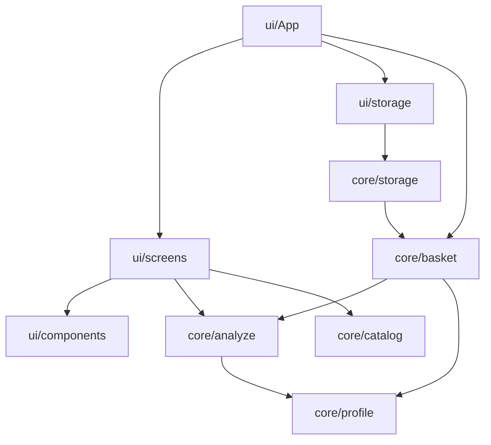
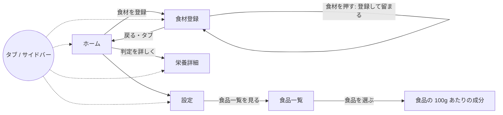

# 設計書（反復 2）: 登録と判定の画面（MVP）

- 文書 ID: DES-IT02
- 版: 0.2（採用。自動マージの条件 4 により、エージェントの判断で採用。REV-009。本人には IT02 の振り返りで提示する）
- 作成日: 2026-10-14
- 更新日: 2026-10-15
- 対象: [反復 2 計画書](../iterations/it02/plan.md) の範囲
- 根拠: [SRS-001 v0.3](../02_requirements/srs.md)、[DES-IT01](design-it01.md)、[ADR-0004](../adr/0004-storage.md)、[REV-013](../reviews/REV-013-it02-decisions.md)
- 取り込んだ文書: 画面設計メモ（旧 docs/screen-design.md）と画面遷移図（旧 docs/screen-flow.md）。内容は本書の 3・6 章に取り込み、メモは削除した（E-45）

> IT04 注記（2026-10-31）: 本文の DES-BSK-01 の使い切った行再利用、DES-BSK-03、DES-BSK-06〜07 の `usedUp`、DES-STO-04 の `usedUp` 検査、DES-UI-20, 40 の使い切った表示、DES-E2E-03 の使い切った操作は、[DES-IT04](design-it04.md) の DES-SHP-01〜03、DES-STO-10〜11、DES-UI-46〜48、DES-E2E-10 で置き換える。本文は IT02 時点の記録として残す。

## 1. 構成

### 1.1 フォルダ（DES-PKG-03 の詳細化）

| ID | 場所 | 責務 |
|---|---|---|
| DES-UI-10 | `src/ui/App.tsx` | 画面の切り替え（ハッシュ）、状態（`useReducer`）、保存の読み書きの呼び出し |
| DES-UI-11 | `src/ui/screens/` | 画面ごとの部品（`HomeScreen`、`RegisterScreen`、`BalanceDetailScreen`、`SettingsScreen`、`FoodsScreen`） |
| DES-UI-12 | `src/ui/components/` | 共通の部品（`BalancePanel`、`ItemRow`、`Navigation` など） |
| DES-UI-13 | `src/ui/storage.ts` | localStorage を触る唯一の場所 |
| DES-UI-14 | `src/ui/ids.ts` | ID を作る（`localId(prefix)`: 接頭辞＋`Date.now()`＋連番。`crypto.randomUUID` は http では使えないので使わない） |
| — | `src/main.tsx` | `src/ui/App.tsx` を描く |

`src/App.tsx` と `src/App.css` は、`src/ui/` に移したあと削除する。

### 1.2 依存の向き



`src/core` から `src/ui` を import しない（DES-PKG-05 の lint で検査済み）。

## 2. 状態と保存（`src/core`）

### 2.1 状態（DES-BSK、`core/basket.ts`）

```ts
type BasketEntry = {
  id: string;           // 登録ごとの ID（画面側で localId で作る）
  foodId: string;       // 食品番号。手入力の食品は manualFoods の id
  displayName: string;  // 登録一覧の食材名（目安重量を引くキー）
  count: number;        // 個数（0.5 刻み、0.5 以上）
  usedUp: boolean;      // 使い切った
};

type AppState = { items: BasketEntry[]; manualFoods: FoodItem[]; profile: Profile };

type BasketAction =
  | { type: "register"; foodId: string; displayName: string; id: string }
  | { type: "increment" | "decrement" | "toggleUsedUp" | "remove"; id: string }
  | { type: "addManualFood"; food: FoodItem; displayName: string; id: string }
  | { type: "setProfile"; profile: Profile }
  | { type: "replace"; state: AppState };
```

| ID | 規則 | 要求 |
|---|---|---|
| DES-BSK-01 | `register`: **食材名と食品番号が同じ**行があれば個数を 1 増やす。使い切ったの行なら、使い切ったを外して個数を 1 にする。なければ個数 1 の行を先頭に足す（P-04、REV-013 #2）。詳細モードで同じ食材名の別の食品を選んだときは、栄養が違うので別の行にする（REV-012） | FR-ING-01, FR-QTY-01 |
| DES-BSK-02 | `increment` / `decrement`: 0.5 ずつ増減する。0.5 未満にも、999 を超える値にもしない（保存データの検査 DES-STO-04 と合わせる） | FR-ING-10, FR-QTY-04 |
| DES-BSK-03 | `toggleUsedUp`: 使い切ったを切り替える（1 回の操作で取り消せる） | FR-ING-11, 12 |
| DES-BSK-04 | `remove`: 行を消す。手入力の食品は、ほかの行から参照されていなければ `manualFoods` からも消す | FR-ING-10 |
| DES-BSK-05 | `setProfile`: 設定を置き換える | FR-STP-01, 02, 04 |
| DES-BSK-06 | 知らない ID への操作は、状態を変えずに返す | — |
| DES-BSK-07 | `toRegisteredItems(state, foodsById)`: 分析用の `RegisteredItem[]` に直す。食品データ → 手入力の順に引き、見つからない行は除く | FR-NUT-06 |
| DES-BSK-08 | 手入力の食品: `id` は `localId("manual")`（`manual-` で始め、食品番号とぶつからない）。棚は `category` を `手入力 / <棚>` として持ち、表示にだけ使う（判定には使わない）。同じ名前でも別の食品として足す | FR-ING-08 |

### 2.2 判定の数え方の補足（DES-ANL-03、IT01 の DES-ANL-01 を補う）

- 「主食を除いて 3 品目」（FR-BAL-05）には、**エネルギーのデータがある食材だけ**を数える（`sumNutrients` がエネルギーのデータがない食品を除くのと合わせる）。エネルギーのデータがない食品（成分を入れなかった、またはエネルギーだけ入れなかった手入力の食品など）は数えず、判定の結果の `noDataItems` に名前を返して画面で知らせる（DES-UI-35）

### 2.3 保存の形式（DES-STO、`core/storage.ts`、ADR-0004）

| ID | 関数・規則 | 内容 | 要求 |
|---|---|---|---|
| DES-STO-01 | `serializeState(state)` | `{ version: 1, items, manualFoods, profile }` の JSON 文字列にする | FR-SYS-01 |
| DES-STO-02 | `parseStoredState(text, knownFoodIds)` | `{ state, issue }` を返す。`issue` は `null` / `"corrupted"` / `{ droppedItems, profileReset }` | NFR-12, 13 |
| DES-STO-03 | 全体を `"corrupted"` にする場合 | JSON として読めない、オブジェクトでない、`version` がない・整数でない・1 未満・今より新しい、`items` が配列でない。初期状態を返す | NFR-12 |
| DES-STO-04 | 1 件ずつ捨てる場合 | 行: `id`・`displayName` が空でない文字列、`foodId` が食品データか読み込めた手入力の食品にある、`count` が 0.5 刻みで 0.5 以上 999 以下、`usedUp` が真偽値。ID が重複したら後ろを捨てる。捨てた行の数を `droppedItems` に入れる | NFR-12 |
| DES-STO-05 | 手入力の食品の検査 | `id` が `manual-` で始まり、食品データの食品番号ともぶつからない。ほかの手入力の食品と ID が重複したら先のものを使う。`name`・`category` が文字列。`refusePct` は null か 0〜100。成分値は null か 0 以上の有限の数（ない成分は null にする）。検査した項目だけで新しいオブジェクトを作る。どの行からも参照されない手入力の食品は捨てる（件数は出さない） | NFR-12 |
| DES-STO-06 | 設定の検査 | 4 つの項目が決まった値のどれかなら、その 4 項目だけで新しいオブジェクトを作る。そうでなければ初期値にし、`profileReset` を true にする（設定がないときも含む）（設計への提案 profileReset の採用。REV-014） | NFR-12 |
| DES-STO-07 | 版の移行 | `migrateStored(stored, migrations)` を export し、`migrations[version]` で 1 つずつ版を上げる。移行がない、または移行しても版が上がらないときは `"corrupted"`。版 1 が最初なので、今の `migrations` は空 | NFR-13 |

画面側（DES-UI-13）の約束:

- 起動時に 1 回読み込む。`issue` が `"corrupted"` のときは、**書き出す前に元の文字列を `weekmeal:state:backup` に退避する**（新しい版のデータを古いアプリが上書きして消さないため）。退避したことを画面で知らせる
- 状態が変わるたびに書き出す
- localStorage が使えない（プライベートモードなど）ときは例外を握りつぶし、保存せずに動き、「保存できない」旨を出す

## 3. 画面（DES-UI）

### 3.1 画面と遷移

| ID | 画面 | ハッシュ | 主な内容 | 要求 |
|---|---|---|---|---|
| DES-UI-20 | ホーム | `#/` | 偏りの判定（BalancePanel）、登録した食材の一覧（DES-UI-40）、「食材を登録」、保存の問題の表示 | FR-UI-01, 03, 06, 07、FR-ING-10〜12 |
| DES-UI-21 | 食材登録 | `#/register` | 棚・検索で絞り込み、食材名を押すと登録する。**登録しても登録画面に留まり**、「にんじんを登録しました（2 本）」と知らせる（まとめて登録しやすくする）。簡易・詳細モード。手入力 | FR-ING-01〜08, FR-UI-04 |
| DES-UI-22 | 栄養詳細 | `#/balance` | 判定する 14 種の充足率と判定（棒と数字、「不足」「適正」「過剰」「不明」の文字）、PFC 比率と目標の範囲、**それ以外のビタミン・ミネラルの充足率**（判定はしない。DES-BAL-06）、カバー率の注記 | FR-UI-05, 06, NFR-07 |
| DES-UI-23 | 設定 | `#/settings` | 主食（ご飯・パン・麺・なし）、盛り（小・中・大）、性別（男性・女性・未選択）、年齢区分。食品一覧への入口 | FR-STP-01, 02, 04, 05、FR-UI-09 |
| DES-UI-24 | 食品一覧 | `#/foods` | 食品データの検索。食品を選ぶと、その食品の 100g あたりの成分を同じ画面で出す（既存の機能を移す） | FR-UI-08 |



- スマートフォン幅（〜767px）は画面下のタブ、PC 幅（768px〜）は左のサイドバー（P-06）
- 画面の切り替えはハッシュの push（ブラウザの「戻る」で前の画面に戻れる）。登録しても画面は変わらないので、「戻る」で二重登録は起きない
- ホームから登録までのタップ数: タブ「登録」→ 食材名 = 2 タップ（棚で絞ると 3 タップ）（NFR-02、H-05）
- タップできる要素は 44×44px 以上（IF-05）。360px で横スクロールしない（IF-03）
- 旧 画面遷移図にあった「ホームの登録食材を選ぶ → その食品の栄養詳細」はなくした。ホームの行は個数の操作に使い、1 つの食品の成分は食品一覧で見られるため。栄養詳細は「買った食材全体」の画面にした（FR-UI-05）

### 3.2 食材登録の規則（画面設計メモから取り込み）

DES-IT01 の DES-CAT-01〜06 で実装済みの規則を、画面では次のように使う。

| ID | 規則 | 要求 |
|---|---|---|
| DES-UI-30 | 初期状態は簡易モード。食材名（`groupFoods` でまとめた名前）を 1 回押すと、代表食品（`representativeFood`、原則「生」）を登録する。状態・部位・量は聞かない | FR-ING-01, 05 |
| DES-UI-31 | 詳細モードは、正式名称・状態・食品番号の一覧から食品を選んで登録する。食材名（`displayName`）は `foodPresentation(food.name, food.category).name` | FR-ING-07 |
| DES-UI-32 | 棚で絞り込む。選べる棚は SRS の 14 種から「米・パン・麺」「調味料」を除いた 12 種（`registrableShelves`、FR-ING-09）と「すべて」。検索語は両モードで共通 | FR-ING-02, 03 |
| DES-UI-33 | 未検索のときは、よくある食材を先に並べる（`prioritizeSupermarketFoods`） | FR-ING-04 |
| DES-UI-34 | 米・パン・麺・調味料・油は出さない（`isRegistrable`） | FR-ING-09 |
| DES-UI-35 | 手入力: 名前と棚（`registrableShelves`）は必須、100g あたりの成分は任意。エネルギーを入れなかった食品は判定に数えず（DES-ANL-03）、その旨を出す。食品データから外れた食材を補う手段でもある | FR-ING-08, FR-FDB-03 |
| DES-UI-36 | 1 食ごとの食事を記録する入口は作らない | FR-ING-13 |
| DES-UI-37 | 食品データにない商品（コーラなど）に、架空の成分値を作らない。補うときは手入力を使う | CST-04 |

棚と表示名の個別の規則（旧 画面設計メモの規則と、置き場所の対応）:

| 規則 | 置き場所 |
|---|---|
| 棚は 14 種（野菜、果物、魚、肉、卵、豆腐・納豆、乳製品、米・パン・麺、惣菜、冷凍食品、飲み物、お菓子、調味料、その他） | `src/data/foodShelves.ts`（`foodShelves`） |
| 野菜には野菜類・きのこ類・いも類を含め、でん粉・でん粉製品は含めない。うめ・アボカドは野菜。こんにゃく・漬物・かに風味かまぼこは豆腐・納豆。冷凍と書かれた食品は冷凍食品。から揚げ・天ぷら・フライは惣菜 | `src/data/foodShelves.ts`（`foodShelf`） |
| 食品ごとの例外の棚（文科省の分類より優先する） | `src/data/foodShelfOverrides.ts` |
| 「（あじ類）」などの分類で食材名をまとめ、「（その他）」のような分類名は食材名にしない。から揚げ・漬物・缶詰・乾燥品などは別の食材名。大豆製品は小分類で分ける | `src/core/catalog.ts`（`foodPresentation`） |
| 分類表記のない別名（たまねぎ → 玉ねぎ、液状乳 → 牛乳、えんどう → えんどうまめ、果実類のかき → 柿 など）と代表食品の指定 | `src/data/foodDisplayNames.ts` |
| よくある食材の並び（地域や季節に合わせて直せる） | `src/data/supermarketFoods.ts` |

### 3.3 ホームの登録一覧（DES-UI-40）

各行に: 食材名、個数と単位（例「2 本」。目安重量がなければ「2 つ（概算）」）、「−」「＋」（0.5 刻み）、「使い切った」（押すと薄く表示し「戻す」に変わる）、削除。使い切った行は一覧の下にまとめる。同じ食材名の行が 2 つあるとき（詳細モードで別の食品を選んだとき）は、正式名称の短い説明（`foodPresentation` の `details`）を添えて見分けられるようにする（REV-012 の申し送り）。

### 3.4 判定の表示（DES-UI-41、DES-UI-01 を引き継ぐ）

- BalancePanel（DES-UI-01）をそのまま使い、設定（`profile`）を反映する。主食の注記は設定に合わせて「主食はパン・大盛りとして計算」のように変える
- 判定しないとき（`insufficient`）の文言は理由ごとに分ける（DES-ANL-01）。成分のない手入力の食品があれば名前を出す（DES-ANL-03）

### 3.5 栄養詳細の基準値（DES-BAL-06）

- 判定しないビタミン・ミネラル（ビタミン E（α-トコフェロール）・K・B6・B12・葉酸・ナイアシン（食事摂取基準は mgNE なので `niacinEquivalentMg` を使う）・パントテン酸・ビオチン、マグネシウム・リン・銅・マンガン・ヨウ素・セレン・クロム・モリブデン）の基準値（推奨量、なければ目安量）を、食事摂取基準（2025年版）から `src/data/dietaryReference.ts` に加える（REV-013 #1）
- 栄養詳細では、これらの充足率（1,000 kcal あたりに直した基準値との比）を棒と数字で出す。判定（不足・過剰）はしない（TBD-11 の解決どおり）

## 4. E2E テスト（DES-E2E、Playwright）

| ID | 内容 | 要求 |
|---|---|---|
| DES-E2E-01 | `e2e/` に置き、`npm run test:e2e` で `vite preview` に対して実行する | QA-03 |
| DES-E2E-02 | 画面幅は 360×740（mobile）と 1280×800（desktop）の 2 つのプロジェクト | IF-03, 04 |
| DES-E2E-03 | 主な流れ: 登録 → ホームで判定 → 個数の変更 → 使い切った・戻す → 設定の変更 → 再読み込みで残る | FR-ING-10〜12, FR-STP, FR-SYS-01 |
| DES-E2E-04 | 壊れた保存データを入れて開くと、初期状態で起動し、その旨が出て、元のデータが退避される | NFR-12 |
| DES-E2E-05 | 360px で横スクロールがない。タップできる要素が 44px 以上 | IF-03, 05 |
| DES-E2E-06 | CI で Chromium を入れて実行する | QA-01, 03 |

## 5. 設計と SRS の対応

| 要求 | 設計 |
|---|---|
| FR-ING-01〜08 | DES-UI-21, 30〜35, DES-BSK-01, 08 |
| FR-ING-09 | DES-UI-32, 34 |
| FR-ING-10〜12 | DES-BSK-02〜04, DES-UI-40 |
| FR-ING-13 | DES-UI-36 |
| FR-FDB-03 | DES-UI-35 |
| FR-QTY-01, 04 | DES-BSK-01, 02 |
| FR-STP-01, 02, 04, 05 | DES-UI-23, DES-BSK-05 |
| FR-BAL-05、FR-NUT-05（表示） | DES-ANL-03, DES-UI-41 |
| FR-UI-01〜09 | DES-UI-20〜24, 40, 41, DES-BAL-06 |
| FR-SYS-01, 02 | DES-STO-01〜07, DES-UI-13 |
| IF-01〜05 | DES-UI-20〜24、DES-E2E-02, 05 |
| NFR-01, 02 | DES-UI-20, 21、DES-E2E-03 |
| NFR-07 | DES-UI-22, 41 |
| NFR-12, 13 | DES-STO-02〜07、DES-E2E-04 |
| NFR-14 | DES-UI-13（localStorage だけを使う） |
| CST-04 | DES-UI-37 |
| QA-03 | DES-E2E-01〜06 |

## 6. 将来の構想（画面設計メモから取り込み。IT02 では作らない）

レシート入力（FR-RCP-01、優先度 W）の構想:

- レシートを撮影し、商品名を読み取り、一般的な食材名にまとめて（例: 国産若どりモモ肉 → 鶏肉、長野県産ぶなしめじ → しめじ）一括で登録する
- 数量はレシートの単位（1 パック、1 袋など）を使い、グラムを強いない。標準量による換算は概算であることを示す
- 「買ったもの」であり「食べたもの」ではないので、摂取カロリーや栄養不足とは断定しない（CST-03）
- 食品でない商品は除き、分からない商品だけ利用者に確かめる

## 7. 変更履歴

| 版 | 日付 | 内容 |
|---|---|---|
| 0.1 | 2026-10-14 | 初版。画面設計メモ・画面遷移図を取り込んだ |
| 0.2 | 2026-10-15 | PR #31 のレビュー（REV-013）と本人の決定を反映。手入力の食品の規則（DES-BSK-08）、判定の数え方（DES-ANL-03）、保存の検査と退避（DES-STO-03〜07）、栄養詳細の基準値（DES-BAL-06）、登録後は登録画面に留まる、棚と表示名の規則の対応表、CST-04 |
