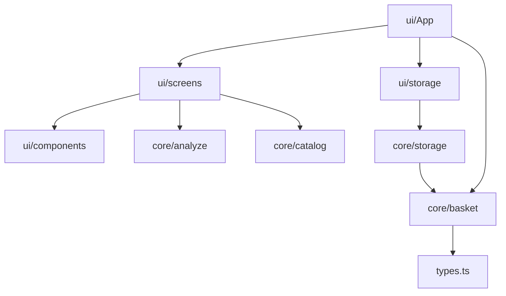
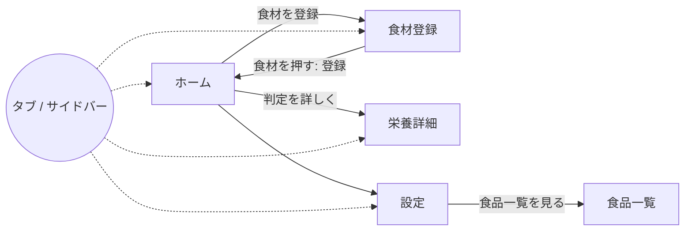

# 設計書（反復 2）: 登録と判定の画面（MVP）

- 文書 ID: DES-IT02
- 版: 0.1（採用。自動マージの条件 4 により、エージェントの判断で採用。REV-009。本人には IT02 の振り返りで提示する）
- 作成日: 2026-10-14
- 対象: [反復 2 計画書](../iterations/it02/plan.md) の範囲
- 根拠: [SRS-001 v0.2](../02_requirements/srs.md)、[DES-IT01](design-it01.md)、[ADR-0004](../adr/0004-storage.md)
- 取り込んだ文書: 画面設計メモ（docs/screen-design.md）と画面遷移図（docs/screen-flow.md）。内容は本書の 3・4 章に取り込み、メモは削除した（E-45）。レシート入力の構想は 6 章に残した

## 1. 構成

### 1.1 フォルダ（DES-PKG-03 の詳細化）

| ID | 場所 | 責務 |
|---|---|---|
| DES-UI-10 | `src/ui/App.tsx` | 画面の切り替え（ハッシュ）、状態（`useReducer`）、保存の読み書き |
| DES-UI-11 | `src/ui/screens/` | 画面ごとの部品（`HomeScreen`、`RegisterScreen`、`BalanceDetailScreen`、`SettingsScreen`、`FoodsScreen`） |
| DES-UI-12 | `src/ui/components/` | 共通の部品（`BalancePanel`、`ItemRow`、`TabBar` など） |
| DES-UI-13 | `src/ui/storage.ts` | localStorage を触る唯一の場所（読み込み・書き出しの呼び出しだけ） |
| — | `src/main.tsx` | `src/ui/App.tsx` を描く |

`src/App.tsx` と `src/App.css` は、`src/ui/` に移したあと削除する。

### 1.2 依存の向き



`src/core` から `src/ui` を import しない（DES-PKG-05 の lint で検査済み）。

## 2. 状態と保存（`src/core`）

### 2.1 状態（DES-BSK、`core/basket.ts`）

```ts
type BasketEntry = {
  id: string;           // 登録ごとの ID
  foodId: string;       // 食品番号。手入力は manualFoods の id
  displayName: string;  // 登録一覧の食材名（目安重量を引くキー）
  count: number;        // 個数（0.5 刻み、0.5 以上）
  usedUp: boolean;      // 使い切った
};

type AppState = {
  items: BasketEntry[];
  manualFoods: FoodItem[];
  profile: Profile;
};

type BasketAction =
  | { type: "register"; foodId: string; displayName: string; id: string }
  | { type: "increment"; id: string }
  | { type: "decrement"; id: string }
  | { type: "toggleUsedUp"; id: string }
  | { type: "remove"; id: string }
  | { type: "addManualFood"; food: FoodItem; displayName: string; id: string }
  | { type: "setProfile"; profile: Profile }
  | { type: "replace"; state: AppState };

basketReducer(state: AppState, action: BasketAction): AppState
```

| ID | 規則 | 要求 |
|---|---|---|
| DES-BSK-01 | `register`: 同じ食材名の行があれば個数を 1 増やす。使い切ったの行なら、使い切ったを外して個数を 1 にする。なければ個数 1 の行を先頭に足す（P-04） | FR-ING-01, FR-QTY-01 |
| DES-BSK-02 | `increment` / `decrement`: 0.5 ずつ増減する。0.5 未満にはしない（0.5 のときの `decrement` は何もしない。削除は `remove`） | FR-ING-10, FR-QTY-04 |
| DES-BSK-03 | `toggleUsedUp`: 使い切ったを切り替える（1 回の操作で取り消せる） | FR-ING-11, 12 |
| DES-BSK-04 | `remove`: 行を消す。手入力の食品は、ほかの行から参照されていなければ `manualFoods` からも消す | FR-ING-10 |
| DES-BSK-05 | `setProfile`: 設定を置き換える | FR-STP-01, 02, 04 |
| DES-BSK-06 | 知らない ID への操作は、状態を変えずに返す | — |
| DES-BSK-07 | `toRegisteredItems(state, foodsById)`: 分析用の `RegisteredItem[]`（DES-ANL-01）に直す。食品が見つからない行は除く | FR-NUT-06 |

ID の生成（`Date.now()` を使う）は画面側で行い、action に入れて渡す（core で実時間を使わない）。

### 2.2 保存の形式（DES-STO、`core/storage.ts`、ADR-0004）

| ID | 関数 | 内容 | 要求 |
|---|---|---|---|
| DES-STO-01 | `serializeState(state)` | `{ version: 1, items, manualFoods, profile }` の JSON 文字列にする | FR-SYS-01 |
| DES-STO-02 | `parseStoredState(text, knownFoodIds)` | `{ state, issue }` を返す。`issue` は `null` / `"corrupted"`（JSON として読めない・形が違う・版が新しすぎる。初期状態を返す）/ `{ droppedItems: number }`（形がおかしい行・知らない食品の行を捨てた） | NFR-12, 13 |
| DES-STO-03 | 設定の形が違うときは、初期値（`defaultProfile`）にする | NFR-12 |
| DES-STO-04 | 版の移行: `migrations[version]` で今の版に直す。版 1 が最初なので、今は空 | NFR-13 |

画面側（DES-UI-13）は、起動時に 1 回読み込み、状態が変わるたびに書き出す。localStorage が使えない（プライベートモードなど）ときは、例外を握りつぶして保存せずに動き、ホームに「保存できない」旨を出す。

## 3. 画面（DES-UI）

### 3.1 画面と遷移

| ID | 画面 | ハッシュ | 主な内容 | 要求 |
|---|---|---|---|---|
| DES-UI-20 | ホーム | `#/` | 偏りの判定（BalancePanel）、登録した食材の一覧（個数の増減・使い切った・削除）、「食材を登録」ボタン | FR-UI-01, 03, 06, 07、FR-ING-10〜12 |
| DES-UI-21 | 食材登録 | `#/register` | 棚・検索で絞り込み、食材名を押すと登録してホームに戻る。簡易・詳細モード。手入力 | FR-ING-01〜08, FR-UI-04 |
| DES-UI-22 | 栄養詳細 | `#/balance` | 判定する 14 種の充足率の一覧（棒と数字、「不足」「適正」「過剰」「不明」の文字）、PFC 比率、カバー率の注記 | FR-UI-05, NFR-07 |
| DES-UI-23 | 設定 | `#/settings` | 主食（ご飯・パン・麺・なし）、盛り（小・中・大）、性別（男性・女性・未選択）、年齢区分。食品一覧への入口 | FR-STP-01, 02, 04, 05、FR-UI-09 |
| DES-UI-24 | 食品一覧 | `#/foods` | 食品データの検索と 100g あたりの成分（既存の機能を移す） | FR-UI-08 |



- スマートフォン幅（〜767px）は画面下のタブ、PC 幅（768px〜）は左のサイドバー（P-06）
- ホームから登録までのタップ数: タブ「登録」→ 食材名 = 2 タップ（棚で絞ると 3 タップ）（NFR-02、H-05）
- タップできる要素は 44×44px 以上（IF-05）。360px で横スクロールしない（IF-03）

### 3.2 食材登録の規則（画面設計メモから取り込み）

DES-IT01 の DES-CAT-01〜06 で実装済みの規則を、画面では次のように使う。

| ID | 規則 | 要求 |
|---|---|---|
| DES-UI-30 | 初期状態は簡易モード。食材名（`groupFoods` でまとめた名前）を 1 回押すと、代表食品（`representativeFood`）を登録する。状態・部位・量は聞かない | FR-ING-01, 05 |
| DES-UI-31 | 詳細モードは、正式名称・状態・食品番号の一覧から食品を選んで登録する | FR-ING-07 |
| DES-UI-32 | 棚（`registrableShelves` の 12 種と「すべて」）で絞り込む。検索語は両モードで共通 | FR-ING-02, 03 |
| DES-UI-33 | 未検索のときは、よくある食材を先に並べる（`prioritizeSupermarketFoods`） | FR-ING-04 |
| DES-UI-34 | 米・パン・麺・調味料・油は出さない（`isRegistrable`） | FR-ING-09 |
| DES-UI-35 | 手入力: 名前と棚（`registrableShelves`）は必須、100g あたりの成分は任意。成分を入れなかった食品は、エネルギーのデータがないので判定に数えられず、その旨を出す | FR-ING-08 |
| DES-UI-36 | 1 食ごとの食事を記録する入口は作らない | FR-ING-13 |

### 3.3 ホームの登録一覧（DES-UI-40）

各行に: 食材名、個数と単位（例「2 本」。目安重量がなければ「2 つ（概算）」）、「−」「＋」（0.5 刻み）、「使い切った」（押すと薄く表示し「戻す」に変わる）、削除。使い切った行は一覧の下にまとめる。

### 3.4 判定の表示（DES-UI-41、DES-UI-01 を引き継ぐ）

- BalancePanel（DES-UI-01）をそのまま使い、設定（`profile`）を反映する。主食の注記は設定に合わせて「主食はパン・大盛りとして計算」のように変える
- 判定しないとき（`insufficient`）の文言は理由ごとに分ける（DES-ANL-01）

## 4. E2E テスト（DES-E2E、Playwright）

| ID | 内容 | 要求 |
|---|---|---|
| DES-E2E-01 | `e2e/` に置き、`npm run test:e2e` で `vite preview` に対して実行する | QA-03 |
| DES-E2E-02 | 画面幅は 360×740（mobile）と 1280×800（desktop）の 2 つのプロジェクト | IF-03, 04 |
| DES-E2E-03 | 主な流れ: 登録 → ホームで判定 → 個数の変更 → 使い切った・戻す → 設定の変更 → 再読み込みで残る | FR-ING-10〜12, FR-STP, FR-SYS-01 |
| DES-E2E-04 | 壊れた保存データを入れて開くと、初期状態で起動し、その旨が出る | NFR-12 |
| DES-E2E-05 | 360px で横スクロールがない。タップできる要素が 44px 以上 | IF-03, 05 |
| DES-E2E-06 | CI で Chromium を入れて実行する | QA-01, 03 |

## 5. 設計と SRS の対応

| 要求 | 設計 |
|---|---|
| FR-ING-01〜08 | DES-UI-21, 30〜35, DES-BSK-01 |
| FR-ING-10〜12 | DES-BSK-02〜04, DES-UI-40 |
| FR-ING-13 | DES-UI-36 |
| FR-QTY-01, 04 | DES-BSK-01, 02 |
| FR-STP-01, 02, 04, 05 | DES-UI-23, DES-BSK-05 |
| FR-UI-01〜09 | DES-UI-20〜24, 40, 41 |
| FR-SYS-01, 02 | DES-STO-01〜04, DES-UI-13 |
| IF-01〜05 | DES-UI-20〜24、DES-E2E-02, 05 |
| NFR-01, 02 | DES-UI-20, 21、DES-E2E-03 |
| NFR-07 | DES-UI-22, 41 |
| NFR-12, 13 | DES-STO-02〜04、DES-E2E-04 |
| NFR-14 | DES-UI-13（localStorage だけを使う） |
| QA-03 | DES-E2E-01〜06 |

## 6. 将来の構想（画面設計メモから取り込み。IT02 では作らない）

レシート入力（FR-RCP-01、優先度 W）の構想:

- レシートを撮影し、商品名を読み取り、一般的な食材名にまとめて（例: 国産若どりモモ肉 → 鶏肉）一括で登録する
- 数量はレシートの単位（1 パック、1 袋など）を使い、グラムを強いない
- 「買ったもの」であり「食べたもの」ではないので、摂取カロリーや栄養不足とは断定しない（CST-03）
- 食品でない商品は除き、分からない商品だけ利用者に確かめる

## 7. 変更履歴

| 版 | 日付 | 内容 |
|---|---|---|
| 0.1 | 2026-10-14 | 初版。画面設計メモ・画面遷移図を取り込んだ |
