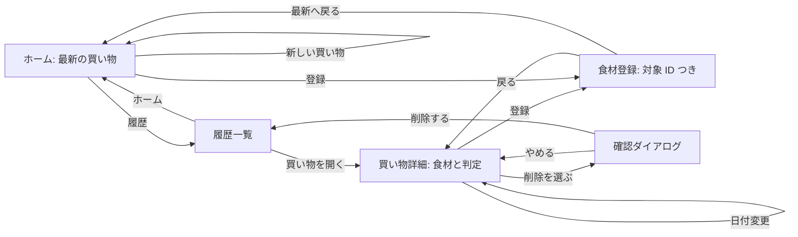

# 設計書（反復 4）: 買い物の単位と公開

- 文書 ID: DES-IT04
- 版: 0.1（設計案。以下の具体的な方式は、本人の決定と明記した P-01〜06・E-70〜74 を除き、エージェントの設計判断）
- 作成日: 2026-10-31
- 対象: [IT04-PLAN v0.2](../iterations/it04/plan.md) 3 章、P-01〜12
- 根拠: [SRS-001 v0.6](../02_requirements/srs.md)、[E-57〜74](../01_concept/elicitation-notes.md)、[DES-IT01](design-it01.md)、[DES-IT02](design-it02.md)、[DES-IT03](design-it03.md)、[ADR-0004](../adr/0004-storage.md)、[ADR-0005](../adr/0005-supplement-suggestions.md)

## 1. 範囲と既存設計との関係

IT04 は登録行を日付つきの買い物に属させる。判定の 14 種・70% / 130% の境界・主食の計算と、不足の赤〜黄は維持する。新しい買い物への食材引き継ぎ、複数の買い物の合算、端末間同期は作らない。`src/core/` は時刻・DOM・保存先に依存しない。

| 旧設計 | IT04 の置き換え・継続 |
| --- | --- |
| DES-BSK-01, 03, 06〜07 | 登録の一致は**同じ買い物内**に限定し、`toggleUsedUp` を廃止。DES-SHP-01〜03 で買い物を選んで操作・分析する |
| DES-ANL-01 | `usedUp` で除外する入口を廃止し、DES-SHP-03 で対象の買い物の全有効行を渡す。換算以降の判定規則は継続 |
| DES-UI-40、DES-UI-20 | ホームの一覧は最新の買い物の行にし、「使い切った」区画・ボタンを廃止。DES-UI-46〜48 |
| DES-E2E-03、DES-PER-01 | 「使い切った・戻す」の操作・計測を買い物作成・履歴編集・削除へ変更。DES-E2E-10、DES-PER-03 |
| DES-SUG-02、ADR-0005 | `usedUp` 行の再利用を廃止し、最新の買い物内の一致・上限だけを見る。DES-SUG-04 |
| DES-BSK-09、DES-UI-45 | 食材 1 行の削除取り消しは買い物 ID と行位置を記録する。別の買い物への編集で取り消し対象を取り違えない。DES-SHP-02 |
| DES-STO-01〜09、ADR-0004 | 版 3 に移行し、買い物と未解決行を保存する。DES-STO-10〜12 |
| DES-COL-01, 02、DES-UI-01, 22, 41 | 不足の配色は維持し、過剰だけ連続尺度にする。DES-COL-03, 04 |

過去のテスト仕様書は実施済みの履歴として保持する。削除した FR-ING-11・12 のケースの扱いは [TST-IT04](../04_test/test-spec-it04.md) 3 章で明記する。

## 2. 買い物の状態と集計

### 2.1 状態・日付・選択（DES-SHP-01）

```ts
type Shopping = {
  id: string;
  date: string; // YYYY-MM-DD、利用者が選ぶ現地の暦日
  origin: "normal" | "usedUpMigration"; // 旧行を分けた来歴
  items: BasketEntry[]; // usedUp を持たない。配列順が登録順
};
type BasketEntry = { id: string; foodId: string; displayName: string; count: number };
type AppState = {
  shoppings: Shopping[]; // 作成順。末尾が後に作った買い物
  manualFoods: ManualFood[];
  profile: Profile;
  unresolvedItems: UnresolvedItem[]; // 5 章
};
```

`shoppings` の位置を作成順の根拠にし、並べ替えない。`latestShopping` は `date` 降順、同日なら配列添字降順で選ぶ純粋関数。ID・日付を変更しても作成順は変わらない。日付は実在する暦日だけ受け付け、日付文字列を辞書順比較できる形式に正規化する。`Date.now()` や ID 生成は画面側に置き、core へ作成 ID と現地日付を action の値で渡す。日付変更で最新が入れ替われば、ホームの対象も即座に入れ替わる。登録画面から来たときは最新、履歴の詳細から来たときは選択した ID を登録先として画面のセッション状態で保持し、URL の買い物 ID と一致させる。選択 ID が削除済みなら最新へ戻す。

### 2.2 reducer と取り消し（DES-SHP-02）

- `createShopping(id, date)`: 重複 ID・不正日付は何もしない。空の買い物を末尾へ追加する。明示的な「新しい買い物」操作では、既存の食材をコピーしない。
- `setShoppingDate(shoppingId, date)`: 対象 ID だけを更新し、作成順と中身を維持する。不正日付・未知 ID は何もしない。
- `register(shoppingId, ...)` / `addManualFood(shoppingId, ...)`: 対象内だけで同じ食品番号と表示名を統合。画面の登録画面からは選択した ID を渡す。買い物が 0 件なら、画面が最初の登録 action に現地日付と新しい買い物 ID を同梱し、reducer が買い物作成と登録を原子的に行う。候補登録も同じ規則。個数の増減・食材削除も買い物 ID と行 ID の組で指定する。
- `removeShopping(shoppingId)`: 6 章の確認後、買い物と所属行をまとめて削除。覚えた食品の台帳と設定は残す。未知 ID は何もしない。最新を消したら残りから再選択し、0 件なら空のホームに戻す。
- 行の取り消し情報は `{ shoppingId, entry, index }` とし、復元対象の買い物が既にないときは復元しない。買い物削除・置換では取り消し情報を消す。買い物そのものの削除は確認方式なので、取り消し情報を保存しない。

reducer は入力を変更せず、新しい状態を返す。無効 action は元の状態を返す。`AppState` の `manualFoods` は買い物を削除しても残す（DES-MAN-01）。

### 2.3 買い物ごとの分析（DES-SHP-03）

`toRegisteredItems(shopping, manualFoods, foodsById)` は、その買い物の解決済み行だけを `RegisteredItem[]` に直す。`RegisteredItem` と `analyzeBasket` から `usedUp` を外し、既存の量換算・欠損・3 品目・主食・14 種の判定規則を再利用する。`analyzeShopping(shopping, state, foodsById)` はこの二段を結ぶ純粋関数で、履歴でも同じ関数を使う。ホームの `analysis` と `suggestSupplements` は `latestShopping` の行だけを受け取る。買い物がないときは「食材を登録してください」の未判定状態と候補 `[]` を返す。前の買い物の編集はその買い物の分析だけを変え、日付変更で最新が入れ替わる場合だけホームの分析対象も変わる。未解決行は数値の判定に含めず、名前と理由を画面へ返す。

## 3. 候補の棚のばらつき（DES-SUG-04）

ADR-0005 の評価式・安全性の順位・候補の比較順は維持し、**上位 3 件を取り出す段階**で棚を分散する。まず全候補を旧順位で並べる。先頭はそのまま採用する。次は未選択で直前と棚が違う最上位候補を選び、なければ未選択の最上位を選ぶ。3 件まで繰り返す。棚は既存の `foodShelves` / `foodShelfOverrides` による登録画面と同じ分類を使い、分類できない候補は「その他」とする。候補集合と順位を改変しないので、棚の違いのために改善 0 以下や新しい過剰を理由に除外済みの候補を戻さない。棚を交互にできる限り、同じ棚の連続を避ける。異なる棚が 1 件しかなければ、その後は旧順位で埋める。入力不変・同点順の再現性を単体テストにする。

## 4. 過剰の色（DES-COL-03, 04）

`balanceTone` は `status === "high"` のときだけ上限超過比 `r` を求める。PFC は `pfcPct / pfcRange[1] - 1`、塩分などの上限規則は `sufficiency / 1.3 - 1`。分母が 0 以下、値が非有限なら警告色なし・「過剰」の文字は残す。`t = clamp(r / 0.5, 0, 1)` とし、`#d8b4fe` から `#a855f7` へ RGB 各成分を線形補間して整数に丸める。上限ちょうどから 50% 超過までを濃淡に割り当て、以後は終点に固定する。0.5 はエージェントの表示尺度で、栄養の判定境界を変える値ではない。不足の `rgb(255, round(255 × lowerTargetRatio), 0)` は DES-COL-01 のまま。紫系と赤〜黄で系統を分け、ホームと栄養詳細のバッジに共通適用する。`ok` / `unknown` は警告色なし。

文字は黒 `#000000` とし、「不足」「過剰」を常に表示する（DES-UI-01、NFR-07）。コントラスト比の計算は WCAG 2.2 の [相対輝度の式](https://www.w3.org/TR/WCAG22/#dfn-relative-luminance) と [1.4.3](https://www.w3.org/TR/WCAG22/#contrast-minimum) に従う。sRGB 成分を 0〜1 にし、0.04045 以下は `c/12.92`、それ以外は `((c+0.055)/1.055)^2.4`。輝度は `0.2126R + 0.7152G + 0.0722B`、黒文字との比は `(L+0.05)/0.05`。**設計時の計算値**は端点で約 11.88:1 と 5.31:1（Python で式を評価）。丸めを含む中間の全色と実際の CSS の上書きは未検査なので、実装 Issue で全 256 段階と実画面の比 4.5:1 以上を検査する。赤〜黄の既存色も同じ検査対象とする。端点の値を全画面の適合実績とは扱わない。

## 5. 保存の版 3（DES-STO-10〜12、ADR-0004 の追記）

### 5.1 形式・移行（DES-STO-10）

キーは `weekmeal:state`、形式は `{version:3, shoppings, manualFoods, profile, unresolvedItems}`。`shoppings` は 2.1 の作成順。`unresolvedItems` は `{shoppingId, id, foodId, displayName, count, reason:"unknownFood"}` の配列で、元の食品番号・名前・個数を保持する。通常の行とは分離し、成分がないまま判定に加えない。`pendingRemoval` や画面の選択先は保存しない。

`migrations[2]` は版 2 の `items` を二分する。既存の `Migrations` の関数型に移行用の `{ date, shoppingIds }` を加え、現地日付と衝突しない 2 つの ID を**UI から引数で受ける**。core 内で時計や乱数は使わない。`usedUp:false` の行を 1 つの買い物、`usedUp:true` の行を別の買い物にまとめる。両方あるときは使い切った側を先に作り、有効側を後に作る。同じ日付なので有効側が最新になる。使い切った側の名称は「以前の食材（移行）」と画面で示すが、保存は表示名を持たず、移行元を示す `origin:"usedUpMigration"` を買い物に付ける。通常の買い物は `origin:"normal"`。片方だけならその 1 件を作り、空の版 2 は買い物 0 件とする。使い切った行だけがある場合、その移行用買い物が最新になるが、その食材を現在の買い物へ自動で混ぜない。`usedUp` 自体は版 3 の行には残さない。版 1 は既存の 1→2 を通ってから移行する。版 2 の読み込みが成功したら版 3 として保存する前に、原文をバックアップへ退避する。退避できなければその起動中の自動保存を止める。

### 5.2 検査と失われない通知（DES-STO-11）

既存の全体破損・将来版の退避と保存停止（DES-STO-09）を継続する。買い物の日付・ID・配列、行の個数・ID、台帳・設定を検査し、余計なキーを持ち込まない。買い物 ID と行 ID はそれぞれ全体で重複を許さず、先に出た値を採る。不正な行は件数と、読める食材名を通知する。**食品データから外した 9 件を参照する版 2 行**は `unknownFood` として `unresolvedItems` に保持し、食材名を通知する（REV-030 #2）。再び同梱食品に戻ったときは読み込み時に同じ買い物の通常行へ戻し、元の行 ID・個数を保つ。未解決行は所属する買い物の画面に名前と個数を表示し、削除は可能とする。成分値は復元できないと明示する。未知 ID でも元の行の ID・個数・表示名が妥当なら保持する。壊れた構造や不正な個数を無理に正常化せず、元の文字列をバックアップして保存を止めるか、既存の `droppedItems` 通知に名前を加える。**通知なしの破棄はしない**。`manualFoods` の台帳は未参照でも保存し続ける。

### 5.3 容量（DES-STO-12）

下書き台帳と履歴に上限を設けない現状を前提に、JSON の UTF-16 文字数を保存前に測り、ブラウザの保存失敗は既存の `StorageNotice` で知らせる。容量はブラウザごとに違い、ここでは保証値を置かない。**設計上の見積もり**として、通常行を平均 150 文字、買い物ヘッダーを 100 文字と仮定すると、100 回の買い物×各 30 行で約 46 万文字、UTF-16 換算で約 0.92 MB。手入力 100 件を各 1,000 文字と仮定すると約 0.2 MB を追加する。これは実データを測った値でも、localStorage の空き容量の保証でもない。実装時に代表試料の `JSON.stringify` 長さ・保存可否・失敗時の通知を記録し、必要なら上限やエクスポートを次の反復の提案にする。上限・自動削除は IT04 には加えない。

## 6. 履歴・画面遷移・削除（DES-UI-46〜48）

`#/history` に日付降順・同日作成順降順の履歴を置き、各買い物の食材数と最新の印を示す。`#/history/<id>` はその買い物の食材一覧・判定・日付編集・削除を示す。前の買い物でも登録・増減・行削除ができる。登録時は `#/register?shopping=<id>` のように対象 ID をハッシュ内に含め、再読み込み・戻るでも対象を取り違えない。ID が見つからなければ履歴へ戻し、その旨を知らせる。ホームは常に最新の買い物だけを示し、新規作成・履歴への入口を置く。買い物が 0 件なら初回登録の入口を示す。



買い物削除は**確認ダイアログ**を選ぶ（DES-UI-48）。行より影響が大きく、履歴と未解決行を含む一まとまりを失うため。日付と食材数を明示し、「削除する」は別のボタンにする。確認前は保存状態を変えない。確認後は `removeShopping` を 1 回 dispatch し、履歴一覧へ移動して削除通知を `role="status"` で出す。Esc / キャンセルは無変更。ダイアログはフォーカスを内部に保ち、閉じたら元の削除ボタンへ、確定後は履歴見出しへ移す。最新を削除したら次の最新をホームで表示し、0 件なら空状態を示す。未解決行も買い物に属するので、その買い物を削除すると一緒に消す。

## 7. 公開・性能・横断試験

### 7.1 GitHub Pages（DES-DEP-01, 02）

Vite `base` を本番ビルドでは `/week-meal/` とする。公開 URL は `https://sakana396.github.io/week-meal/`。Pages の `build_type=workflow` は 2026-10-27 に有効化済み（IT04-PLAN P-10）。`main` への push で GitHub Actions が `npm ci`、型・lint・書式・単体テスト・ビルド・E2E の成功を確認した後、`dist` を Pages artifact として upload し、`deploy-pages` で配信する。PR では配信せず検証だけ行う。`pages: write` と `id-token: write` は配信 job にだけ付け、`environment: github-pages` に URL を記録する。現行 CI は check / e2e の 2 job であり、配信 job は新設する。ローカルの `vite preview` は `/week-meal/` を含む URL を Playwright の `baseURL` にし、ヘルパーの遷移は相対 URL またはハッシュを使う。E2E のポート衝突は `--strictPort` の失敗として分かるようにし、並列起動しない。公開 URL では手動の登録→判定→再読み込みを確認し、localhost の localStorage は移さない（E-73）。通信監査で登録・設定を送る fetch / XHR がないことを確認する。既存の ADR-0001 の静的サイト方針に沿うため、新たな技術選定 ADR は不要と判断する。

### 7.2 計測と E2E（DES-PER-03, 04、DES-E2E-10）

DES-PER-01 のクリック受信から判定 commit 後 2 回目の `requestAnimationFrame` までの方法を使う。操作は最新と前の買い物での登録・個数変更・行削除、最新が変わる日付変更を測る。「使い切った」は外す。試料は 3 / 30 / 100 行を**対象の買い物**に置き、別の履歴 100 件を加えた条件も測って履歴数の影響を分ける。各条件 5 回、CPU 制限なしと 4 倍 slowdown を記録し、CI の時間超過は記録のみ。中位のスマートフォン相当の合意された環境で全件 100 ms 以内なら NFR-03 達成とする。端末条件が定まらなければ未確認と記録する。候補計算は従来どおり別時計。履歴の編集と日付変更で古い候補の revision が残らないことも検査する。

Lighthouse は反復末に**公開 URL**で mobile 設定の Performance を手動計測し、スコア・日時・URL・コミット・Chrome / Lighthouse 版・機器・設定を振り返りへ記録する（DES-PER-04、NFR-04、QA-04）。目標値は置かない。履歴と確認ダイアログは既存の axe の重大違反 0 件の対象へ追加し、mobile / desktop の E2E で画面遷移・編集・削除・保存復元を確かめる。

## 8. 実装 Issue の分け方の案（P-11）

| 案 | 対象 | 要求・設計 ID | 依存 | 作らないもの |
| --- | --- | --- | --- | --- |
| A | 状態・保存版 3・買い物ごとの集計と移行 | FR-ING-17, 18、FR-NUT-07、FR-SYS-01、NFR-12, 13 / DES-SHP-01〜03、DES-STO-10〜12 | なし | 履歴画面・公開 |
| B | ホーム・登録画面の買い物対応 | FR-ING-17, 18、FR-NUT-07、FR-UI-02 / DES-UI-46、DES-E2E-10 | A | 履歴の編集・削除 |
| C | 履歴・前の買い物の編集と削除 | FR-ING-19, 20、FR-UI-02 / DES-UI-47, 48、DES-E2E-10 | A、B | 買い物の統合・複数合算 |
| D | 過剰の色と全段階のコントラスト検査 | FR-UI-06、NFR-07 / DES-COL-03, 04 | なし | 不足の配色変更 |
| E | 候補の棚分散 | FR-BAL-08 / DES-SUG-04 | なし | 評価式・棚分類の変更 |
| F | Vite base と Pages ワークフロー | FR-SYS-03、NFR-14 / DES-DEP-01, 02 | なし | 独自ドメイン・データ同期 |
| G | 性能・公開 URL・axe の横断検証 | NFR-03, 04, 06、QA-03, 04 / DES-PER-03, 04、DES-E2E-10 | A〜F | 判定式の変更 |

A の前に B・C を実装せず、D・E・F は main 起点で並列に作れる。依存が閉じてから着手する。Issue 番号は起票時に付くため、ここでは案の記号を使う。

## 9. 設計と SRS の対応

| 要求 | 設計 |
| --- | --- |
| FR-ING-17, 18 | DES-SHP-01, 02、DES-UI-46 |
| FR-ING-19, 20、FR-UI-02 | DES-SHP-02, 03、DES-UI-47, 48、DES-E2E-10 |
| FR-NUT-07 | DES-SHP-01, 03、DES-UI-46, 47 |
| FR-SYS-01、NFR-12, 13 | DES-STO-10〜12 |
| FR-UI-06、NFR-07 | DES-COL-03, 04 |
| FR-BAL-08 | DES-SUG-04 |
| FR-SYS-03、NFR-14 | DES-DEP-01, 02 |
| NFR-03, 04、QA-04 | DES-PER-03, 04 |
| NFR-06、QA-03 | DES-E2E-10 |

FR-ING-11・12 は SRS v0.5 で削除済み。対応する新規実装はない。旧テストの廃止と置換試験は TST-IT04 3 章に記す。

## 10. レビューで確かめる点・計画・要求への提案

- **レビューで確かめる点**: 使い切った行を別の移行用買い物に残す方式、未解決行の表示と再解決、買い物削除の確認、紫の尺度、候補の交互選択、Pages の配信権限と E2E base。いずれもエージェントの設計判断であり、本人の発言として扱わない。
- **計画・要求への提案**: なし。P-09 の「版 2 の食材は 1 つの買い物にまとめる」を有効行のまとまりに適用し、使い切った行だけ別の移行用買い物に残す。これは P-09 が設計書に委ねた扱いで、データを黙って捨てないための具体化と解釈する。もし「すべての行を必ず 1 つにする」という解釈なら、IT04-PLAN の P-09 の文面との整合をレビューで確認する。
- IT03 振り返り 5 章の実機条件と Lighthouse の本人の記入は未確認。達成したものとして記さない。保存データの容量見積もりとコントラストの端点計算も実機・全色の実測ではない。

## 11. 変更履歴

| 版 | 日付 | 内容 |
| --- | --- | --- |
| 0.1 | 2026-10-31 | IT04 の状態・履歴・移行・色・候補・公開・性能の設計案と Issue 分割案 |
