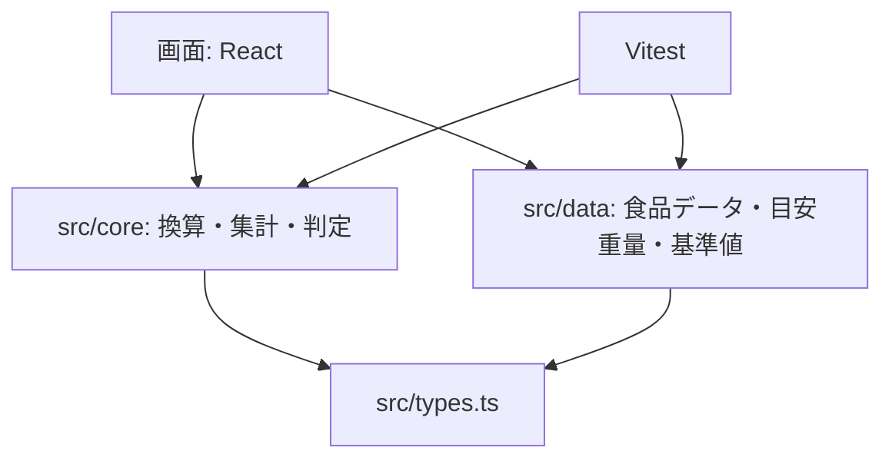

# ADR-0001: 技術スタックと開発基盤

- 状態: 採用（自動マージの条件 4 により、エージェントの判断で採用。REV-009。本人には IT02 の振り返りで提示する）
- 日付: 2026-10-14
- 根拠: SRS-001 CST-02、NFR-08〜10、QA-01〜03、PLAN-001 P-01

## 背景

- 既存の実装は TypeScript ＋ React 19 ＋ Vite 8 で、ブラウザだけで動く静的サイトである（CST-02）
- 第一の目的は就活用のポートフォリオで、品質を説明できることが重要（E-32, E-35）
- 計算のロジックは React に依存しない純粋な関数として、単体テストで検証する（NFR-08, 09）
- スマートフォン優先で、PC にも対応する（E-31）

## 決定

| 用途 | 採用 |
|---|---|
| 言語 | TypeScript（strict） |
| UI | React 19 |
| ビルド・開発サーバー | Vite 8 |
| 単体テスト | Vitest、網羅率は `@vitest/coverage-v8` |
| E2E テスト | Playwright（IT02 で導入） |
| 静的解析 | ESLint（typescript-eslint、eslint-plugin-react-hooks） |
| フォーマット | Prettier |
| CI | GitHub Actions |
| 保存 | ブラウザの localStorage（TBD-13 の仮置き。IT02 で別 ADR にする） |
| 配信 | 静的サイト（配信先は IT03 で決める） |
| 実行環境 | Node.js 22.12 以上（`.nvmrc`） |

### 構成方針

計算の規則は React に依存しない `src/core/` に置き、画面は `src/` 直下（IT02 で `src/ui/` に整理する）に置く。依存の向きは ESLint の `no-restricted-imports` で検査する（NFR-08）。

## 理由

- **既存の実装を活かせる**: 言語や枠組みを変える理由がない
- **Vite と同じ設定で動く**: Vitest は Vite の設定をそのまま使えるため、設定が少ない
- **説明しやすい**: ロジックを純粋な関数に分けると、テストの網羅率と依存の向きを機械的に示せる

## 検討した代替案

| 案 | 採用しなかった理由 |
|---|---|
| Jest | Vite との設定の二重管理になる。ESM の扱いで手間がかかる |
| Biome（lint とフォーマットを一本化） | 有力だが、React Hooks の規則の検査は ESLint のプラグインの方が実績がある |
| Next.js などのフレームワーク | サーバー機能は要らない（NFR-14 で外部送信もしない）。静的サイトで足りる |

## 影響

- Node 18 では Vite 8 が動かないため、Node 22 が必要（README に記載済み）
- 既存のコードに Prettier をかけるため、最初の 1 回だけ差分が大きくなる

## IT03 の補足（2026-10-25、Issue #52。採用）

配信を IT03 で決める予定は、本人の決定 E-54（2026-10-24）と IT03-PLAN P-03 により後の反復へ延期した。IT03 では配信先を決めず、公開せず、ビルドできる状態を保つ。上の配信の行は当初の予定として残す。
