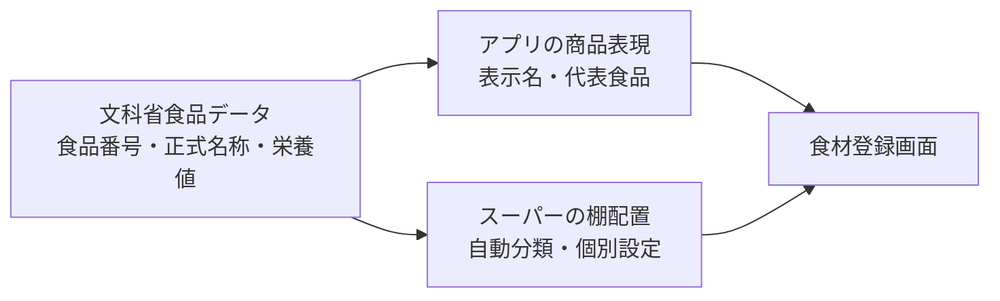

# データ設計

weekmealでは、文科省の栄養データと、アプリ上の表示・スーパーの棚配置を分けて管理します。

## 基本方針



- 文科省データは原典として保持し、表示名や棚の都合で書き換えない
- 利用者向けの表示名と、複数の食品をまとめる設定は別に管理する
- スーパーの棚は栄養分類とは別に管理する
- 個別配置を増やしても、栄養データの複製は作らない

## 現在のファイル

| ファイル | 役割 |
|---|---|
| `src/data/foods.json` | 文科省の食品番号、正式名称、分類、100g当たりの栄養値 |
| `src/data/foodDisplayNames.ts` | 一般的な表示名への統合、登録時に使う代表食品 |
| `src/data/foodShelves.ts` | 文科省分類や食品名からスーパーの棚を決める通常ルール |
| `src/data/foodShelfOverrides.ts` | 食品番号ごとの個別の棚変更 |
| `src/data/supermarketFoods.ts` | スーパーでよく見かける食品の優先表示順 |

## 棚の決定順

1. `foodShelfOverrides.ts` に食品番号の指定があれば、その棚を使う
2. 指定がなければ `foodShelves.ts` の通常ルールで判定する
3. 通常ルールにも当てはまらなければ「その他」に置く

例えば、カスタードプリンときんつばは文科省分類ではどちらも「菓子類」です。ただし、食品番号 `15086` のカスタードプリンだけを個別設定で「乳製品」に置き、食品番号 `15016` のきんつばは通常ルールにより「お菓子」に置きます。文科省では「乳類」のアイスクリームやシャーベットも、個別設定によって「冷凍食品」に置きます。

## 個別配置を追加する方法

`src/data/foodShelfOverrides.ts` に、文科省の食品番号と移動先の棚を追加します。

```ts
export const foodShelfOverrides = {
  "15086": "乳製品", // カスタードプリン
};
```

正式名称ではなく食品番号をキーにすることで、似た名前の商品を誤ってまとめて移動することを防ぎます。

## 将来データベースへ移行する場合

個別設定が増えても、現段階ではTypeScriptの設定ファイルで管理できます。管理画面、JANコード、店舗別の棚、複数人での編集が必要になった時点で、次のテーブルへ移行します。

| テーブル | 主な内容 |
|---|---|
| `source_foods` | 文科省食品番号、正式名称、栄養値、データ版 |
| `catalog_items` | アプリ上の商品名、代表となる文科省食品番号 |
| `shelves` | 棚ID、棚名、表示順 |
| `catalog_item_shelves` | 商品と棚の対応、優先棚、必要なら店舗差 |

棚ごとに栄養データベースを分割せず、商品と棚の対応だけを変更できる形を維持します。
