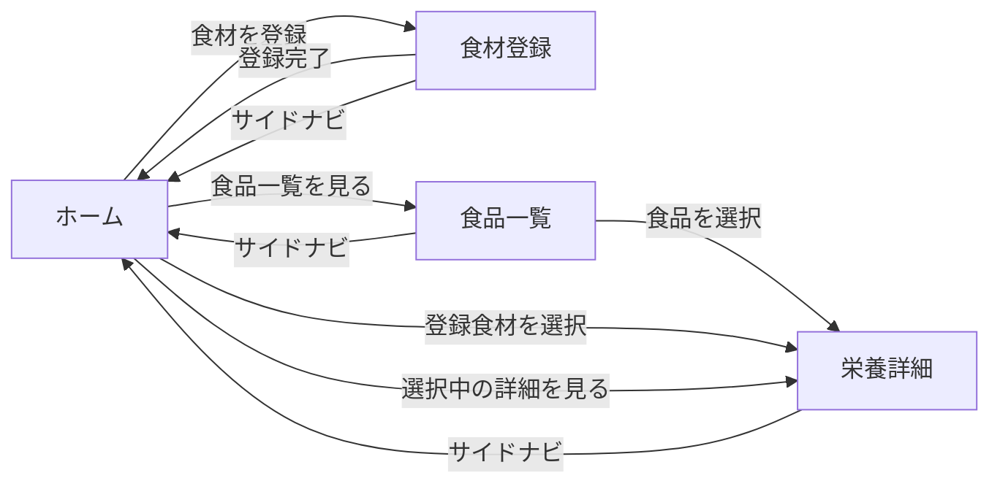
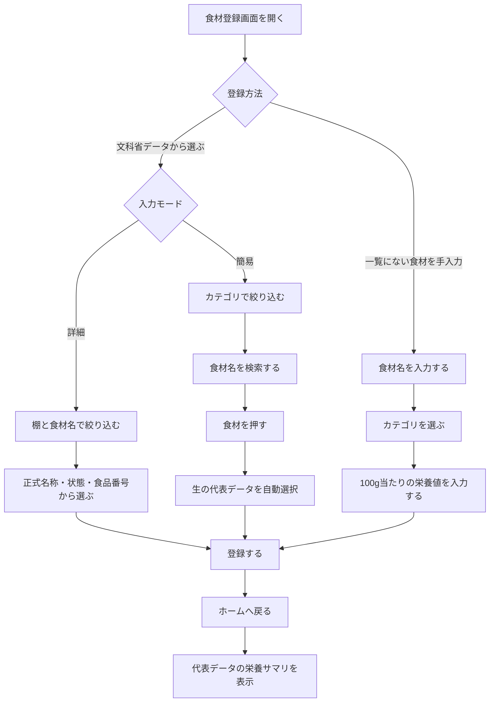
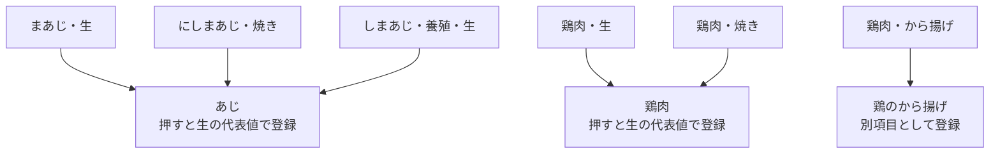
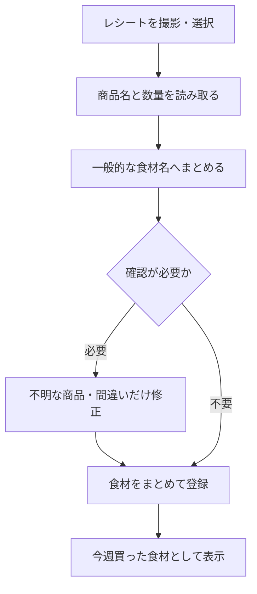

# 画面遷移図

weekmeal の画面間の移動と、各画面内の主な操作をまとめます。
画面や導線を変更したときは、この図も更新します。

詳しい画面仕様は [画面設計メモ](screen-design.md) を参照してください。

## 全体の画面遷移

すべての画面からサイドナビを使って、ホーム・食材登録・食品一覧・栄養詳細へ直接移動できます。

## 食材登録の操作フロー

## 食材名のまとめ方

文科省データの正式名称は内部に保持したまま、登録画面では一般的な食材名にまとめます。
生・ゆで・焼き等は分けず、栄養値が大きく変わる加工品は別項目にします。

## 将来構想: レシート入力

この遷移は未実装です。将来検討する入力方法として記録しています。

